# WellnessHub C 端按次服务收费 PRD

版本 **v2.3.0** · 2026-11-12 · 业务及交互评审稿

[三端交互评审](./付费模式-完整需求文档.html#client-cpay-store) · [v2.2.0 备份与回退](../versions/payment-v2.2.0-before-v2.3.0-20261112/README.md)

原版 H5 v0.2.21；未修改童允强版本。本文同步提供 HTML 正文及 MD 源稿；三栏 HTML 保留左侧平台与增量目录、中间可操作 Demo、右侧页面规则。当前为本地模拟，不接真实支付、AI 或线上账户。

## 业务目标与边界

用户测量并扫码查看报告后，按次购买 AI 报告解读或训练大纲。C 端 Pro 不代表订阅或无限次使用；本期不包含 AI 咨询。B 端 Pro 的套餐、AI 咨询、积分包、赠分继续沿用已有规则。

| 规则 | 关闭 | 客户开启 | 维塑统一开启 |
| --- | --- | --- | --- |
| 大中台配置权 | 维塑运营 | 维塑授权客户 | 维塑运营 |
| B 端 Pro | 原规则 | 必须有效 | 开展 C 服务无须购买 |
| 谁定价、收款 | 沿用原服务规则 | 客户 | 维塑 |
| Hub 收费模块 | 整体隐藏 | 显示开关；开启后展开配置 | 整体隐藏 |
| 服务成功扣分 | 原 B 端规则 | 所属 B 客户积分池 | 通用积分机制下的平台承担账户，生产来源待定 |
| 分账 | 无新增 | 客户收款 | 试运行线下分账 |

支付渠道和支付方式由平台集成。客户只配置收款主体资料，不能将填写资料等同于真实支付系统已完成结算账户接入。生产接入能力由平台另行完成。

**售卖方案仍待选择**：Demo 支持分别收费（每项一次独立价格）或组合收费（一个价格购买两项各一次），用于评审，不代表已决定同时上线。两项服务独立，训练大纲无需先购买 AI 解读。首期演示权益绑定客户、用户、报告与服务类型；同一结果回看不收费，失败任务重试不重复购买。主动再次生成及权益长期有效期仍待定。

## 跨端流程

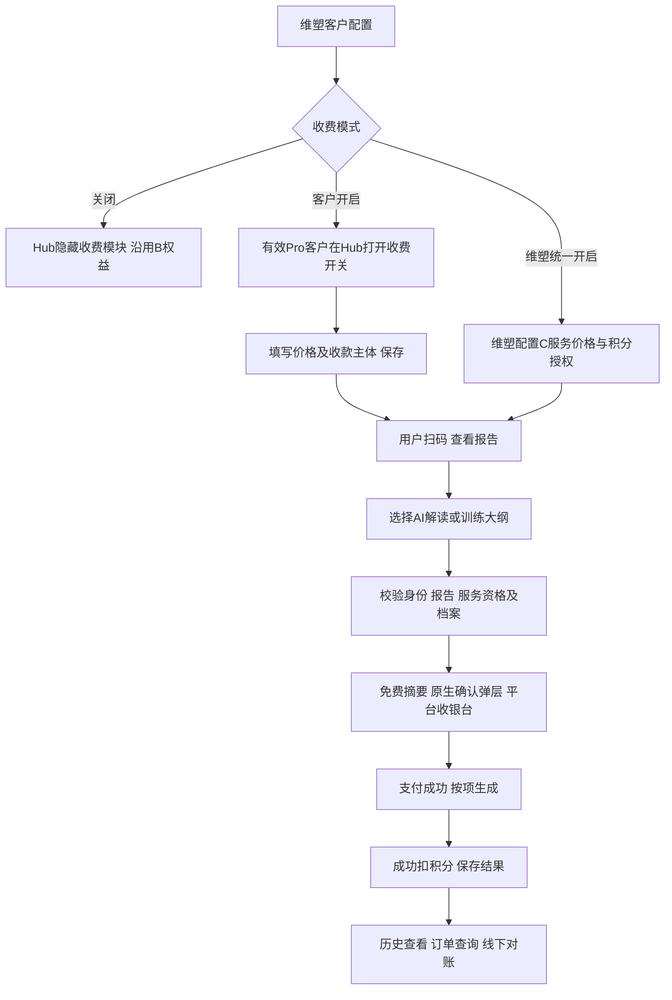

后台与 Hub 本次只同步共享状态，以下后台配图沿用 v2.2.0 已核对基线，页面视觉未重做。H5 配图均为本次实际交互截图。

## 大中台：授权与价格

入口：客户信息管理 → 客户配置 → 其他配置。保留原设备／对接／其他配置页签，新增收费模式下拉框，选项为关闭、客户开启、维塑统一开启。

- 关闭只关闭新增 C 收费，不删除原 B 权益、积分、订单或结果。
- 客户开启授权后，由客户在总门店配置中决定是否收费；无有效 Pro 不能启用收费。
- 维塑统一开启免 B Pro，Hub 不展示收费配置；价格入口位于积分模式配置 → C 端服务定价。
- 维塑价包含收费方式、币种、解读价／大纲价或组合价。金额为正数、最多两位小数，币种必填。取消恢复已存值，保存后新订单采用新规则。
- 价格、收款主体、商品范围、模式及积分规则写入订单快照。配置变更关闭未付订单，已付保留原购买条件；客户 Pro 到期另按暂停规则执行。
- 试运行不配置分佣比例、基数或自动打款；金额与积分互不替代，C 付款不自动给 B 积分充值。

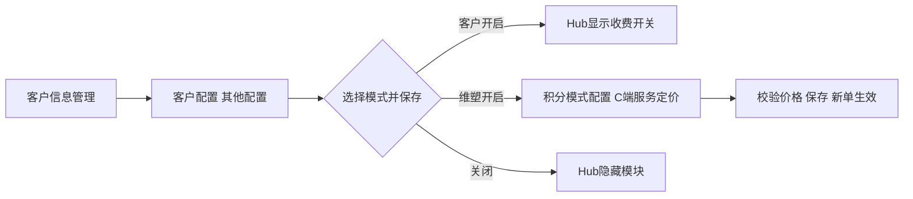

## 客户 Hub：收费开关与主体

入口：门店管理 → 总门店 → 编辑 → 平台配置。使用既有名称、Logo、移动端查看 AI 内容配置页面，在原 AI 开关下增加收费区域。

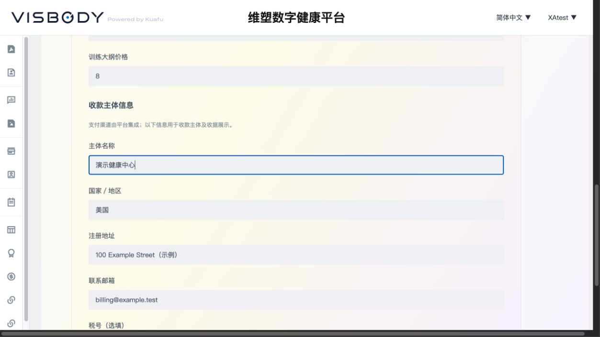

| 状态 | 显示及操作 |
| --- | --- |
| 关闭／维塑统一开启 | 完全隐藏 C 端 Pro 收费模块，不显示解释占位文字 |
| 客户模式、收费关闭 | 只显示标题与“是否开启 C 端付费”开关 |
| 客户模式、收费开启 | 展开收费方式、币种、对应价格及收款主体资料 |
| 客户模式、Pro 到期 | 显示警示和续费入口；保留原配置但禁止编辑和启用 |

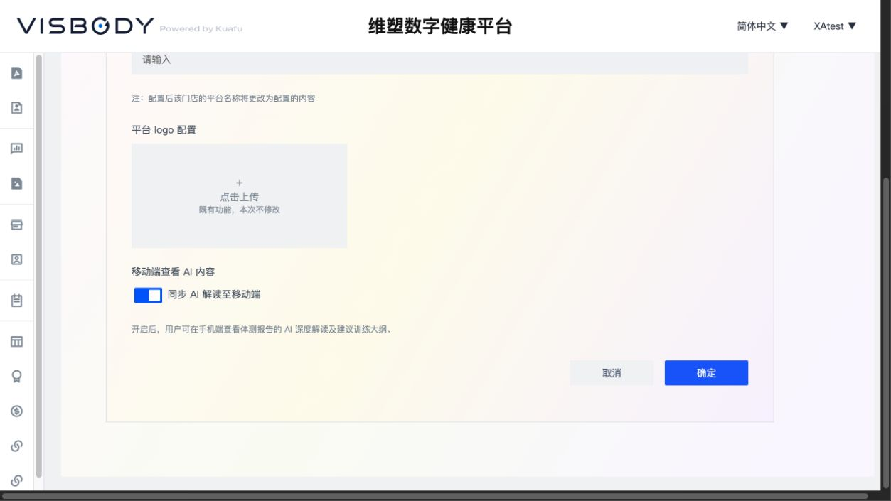

去掉“运营模式”“B 端 Pro 状态”“收款账户状态”等正常状态说明。收款主体表单中，主体名称、国家／地区、注册地址、联系邮箱必填，税号选填；邮箱校验格式。主体名称用于付款确认、订单和收据；订单保留购买时的主体快照。

用户打开开关只是展开表单。点击确定后统一校验有效 Pro、价格与主体资料，通过后才生效；错误显示在当前表单，不悄悄保存为开启。关闭保存时不强制校验已隐藏字段，保留历史价格及主体资料；取消恢复已保存配置。

不提供商户渠道选择、银行卡、密钥或“连接商户”按钮。平台支付接入与客户主体信息是不同事项。总门店统一配置，当前版本不增加子门店独立定价。

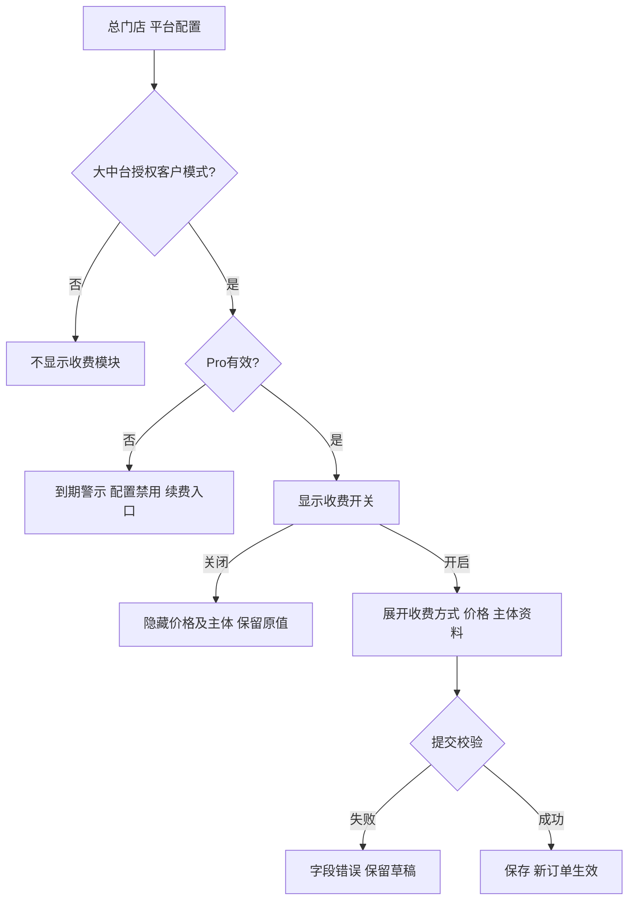

## Pro 到期与历史服务

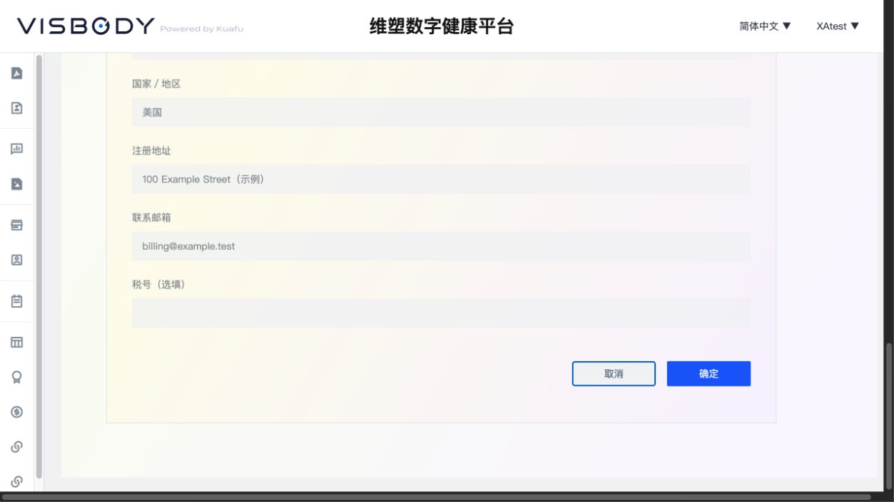

Hub 警示：**“PRO 已到期，C 端新购买及新生成服务已暂停。历史已生成内容仍可查看，请续费后恢复服务。”** 操作：续费 PRO，进入原套餐购买流程。

- H5 隐藏新预览、新购买、新生成入口；基础报告不受影响，已生成解读和大纲仍可查看。
- 已付款未生成、生成失败待重试的服务暂停。订单展示暂停原因及申请未交付服务退款入口。
- 续费恢复未退款权益；退款处理中仍不可生成，避免同时退款和交付。
- 组合部分交付保留成功项结果，仅未交付项不支持在线申请退款，金额由人工审核，不假定等分或按单品价拆分。
- 下单、支付、生成均再次校验到期状态；仅隐藏按钮不构成权限控制。
- 维塑模式不要求 B Pro，其可交付条件由维塑授权和积分额度决定。

## 用户 H5：先看内容，再付费解锁

普通原版 `http://127.0.0.1:4173/#/me` 与具体测量报告均接入本流程。主页、报告、设置沿用原版组件；新增阅读、订单页使用同一字号、颜色令牌、导航、按钮、滚动及安全区。支持中文、英文、德文、阿拉伯文及深浅主题。三栏中使用同源构建；4173 与 5197 不自动共享浏览器存储。

### 服务入口与免费预览

报告入口为“免费查看解读预览”，主页训练入口为“查看我的训练方向”。已有完整结果直接查看，不再次购买。若已单买一项，之后门店切换为组合售卖，暂拦截重复组合购买并提示联系门店确认剩余项方案；升级补差价规则待确认，不自行折算。到期隐藏新的预览、购买和生成入口，保留历史结果与订单。基础报告不收费。营销信息只解释可获得的内容，不制造风险评分、购买人数或限时优惠。

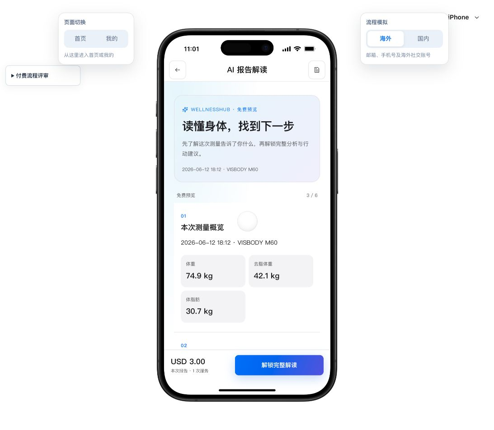

AI 预览包含本次测量概览、报告已标记的关注方向及一个完整分析章节。数值、测量日期及覆盖维度来自当前报告，不跨报告复用同一结果。训练预览包含目标、阶段概览及完整起步说明；其余阶段与具体执行建议待解锁。

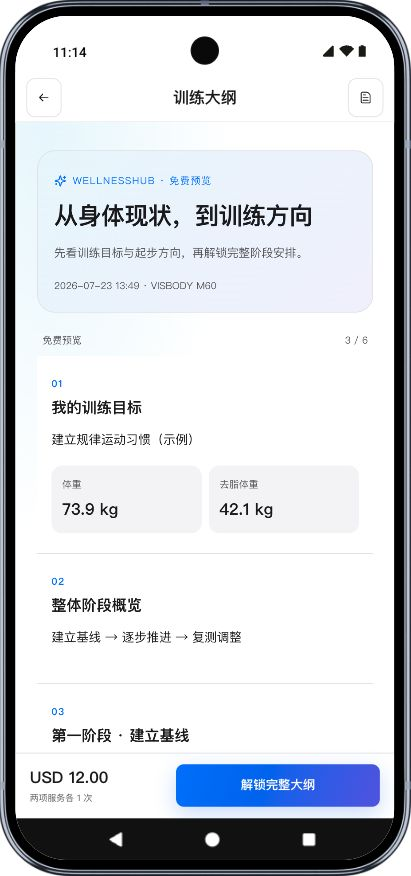

按完整章节划分，Demo 为三章预览、三章完整扩展。目标约一半可预览，不机械截字；动作说明、注意事项不能从中间截断。锁定区只列章节标题及价值说明，不返回完整正文，不堆叠模糊文本。门店承担场景不显示付费锁，以原有权益生成。

训练缺少资料时先补训练目标、运动习惯、运动限制，三个字段必填，完成后返回预览。使用原生键盘控件，导航前收起键盘。当前为简化示例资料，不冒充生产健康问卷；不要输入真实个人健康信息。

### 固定购买区与原生确认弹层

底栏始终可见，展示金额、币种、购买范围与“解锁完整解读／大纲”。组合明确两项各一次；正文预留底栏和安全区空间。已付未交付显示“生成完整内容”，失败显示“免费重试”；已生成结果不显示购买栏。

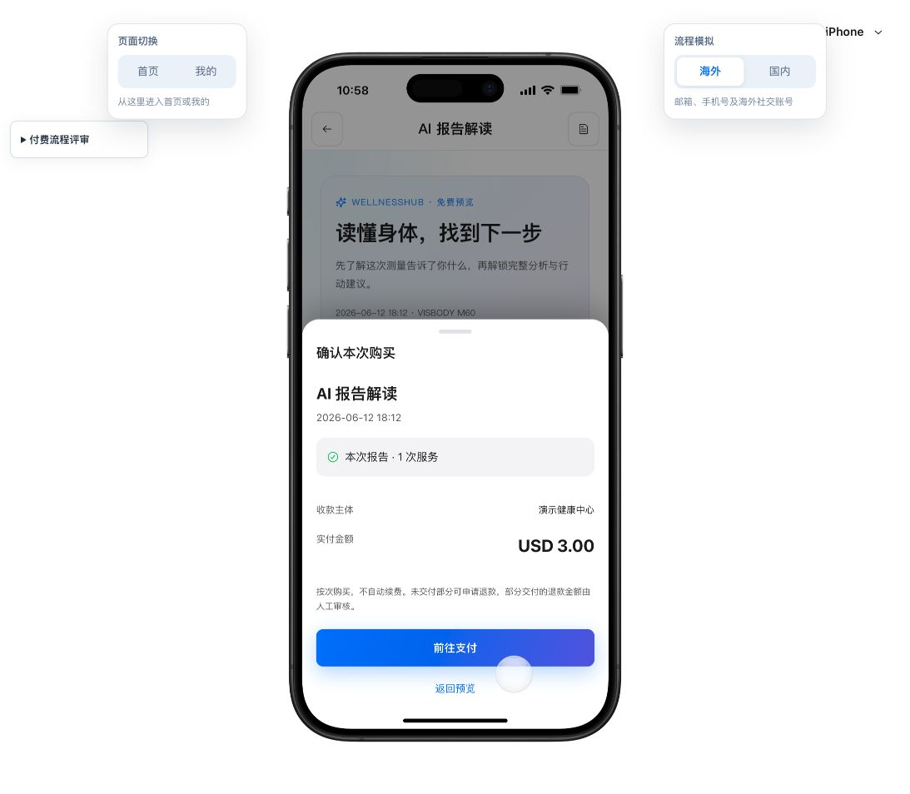

点击解锁先复核资格、额度及报价，再弹出项目原生 BottomSheet，展示商品、关联测量、次数、收款主体、实付总价和退款范围。价格变更时保留摘要并提示“价格已更新，请确认最新报价后继续”，更新报价后由用户再次确认，不静默按新价扣款。主体来自订单快照，尚未建单时使用当前配置。

### 收银台、回跳与原页展开

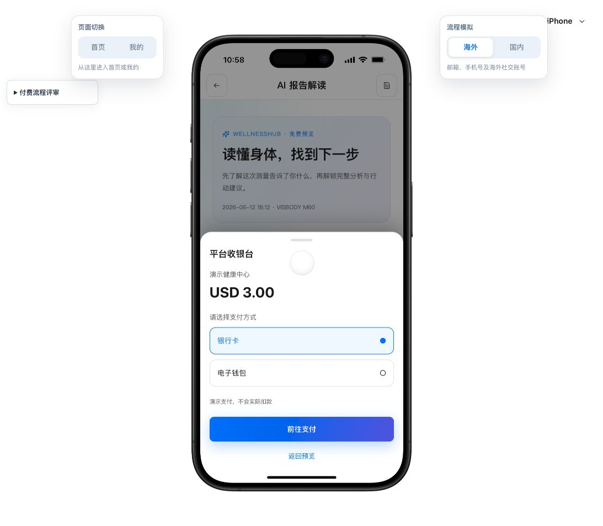

确认购买才创建或恢复订单，进入同一原生弹层中的收银台。可选择演示银行卡／电子钱包，明确不会实际扣款。支付中阻止重复提交；失败保留原订单和摘要，可更换方式重试。“返回预览”关闭弹层、保留待支付订单与阅读上下文，不撤销已付款权益，不要求重新填资料。

付款成功关闭弹层，在原预览页锁定区域显示生成进度。已读章节不变，滚动容器不重建；成功原位补全章节。生成失败原位提示“暂未生成成功，重试无需再次付费”，提供免费重试及订单入口。组合另一项保留独立使用入口，不重复付款。

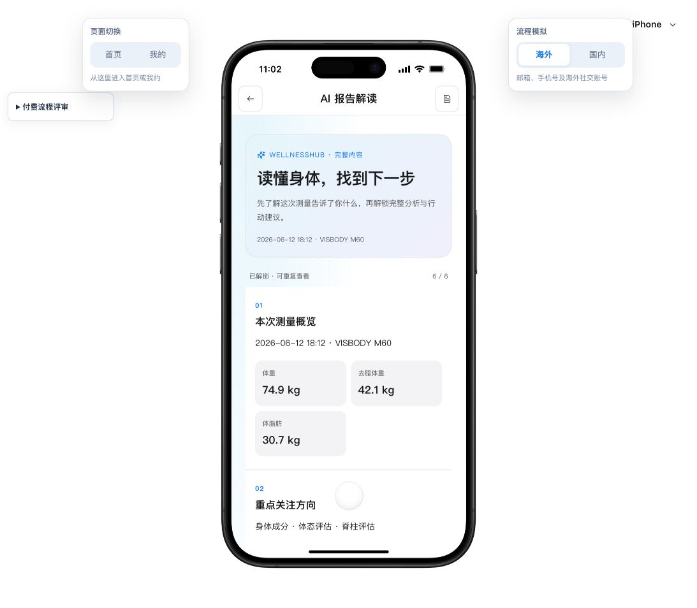

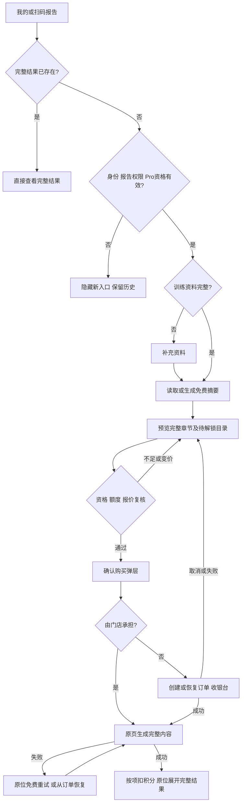

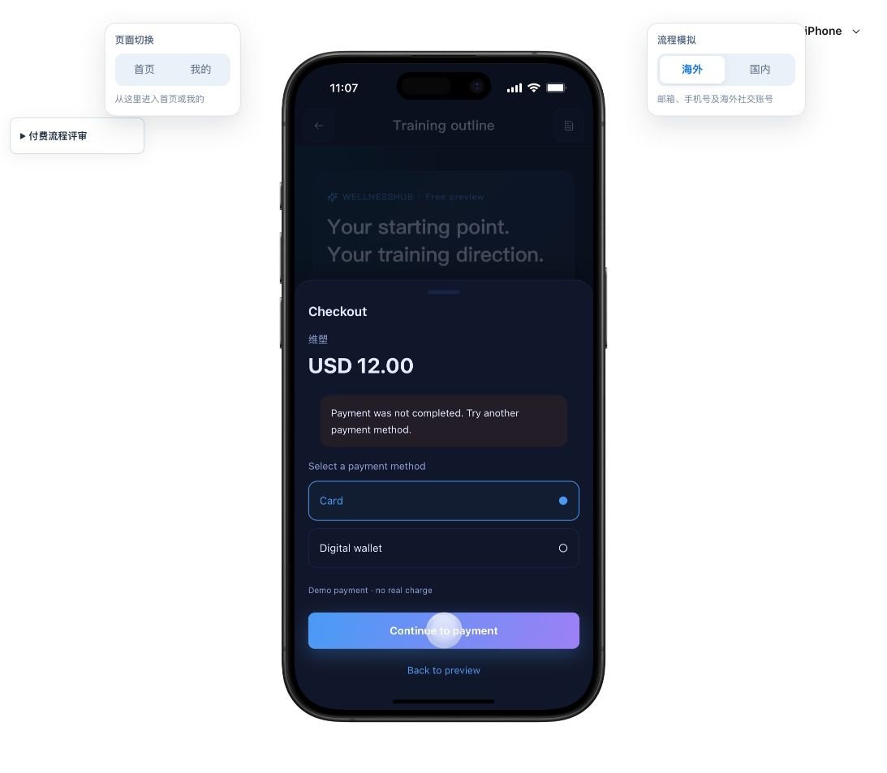

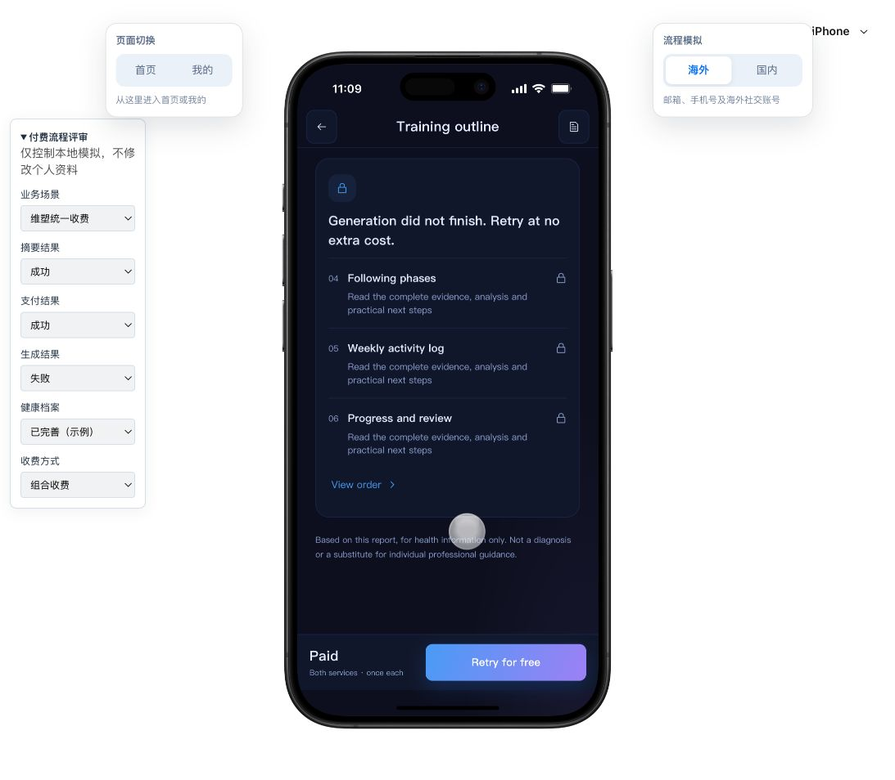

### 摘要、完整结果与服务接口

**免费个性化摘要由平台承担成本；付款后生成完整服务，成功时按原规则扣积分。** 摘要不扣 B 积分、不消耗购买次数、不算交付。不得把摘要生成失败作为扣费理由。

- 摘要键：客户、用户、报告、服务、报告输入版本；训练额外关联健康档案版本。重复打开复用摘要。
- 摘要与完整结果独立保存；订单冻结摘要对应的输入版本、商品、价格、主体及扣分规则。后续资料变化不改变已购内容、不自动创建收费。
- 完整接口校验用户归属、已支付权益及子项交付状态。摘要响应只包含已开放章节与锁定目录；完整正文仅在成功交付后读取。
- 每项成功生成只入账一次；失败不扣，重试复用原订单。组合分别生成和扣分；付款本身不扣分。
- 到期后的已付款未交付仍暂停，不支持在线申请退款；续费恢复未退款权益。已交付回看不受影响。
- Demo 接口：`getSummary`、`getQuote`、`createFromSummary`、`queryPayment`、`generateFull`、`readFull`。这些是模拟服务边界，生产访问控制、并发锁、回调验签及数据库事务必须由后端执行，浏览器存储不是安全边界。

| 页面状态 | 展示与操作 |
| --- | --- |
| 摘要加载 | “正在整理你的预览…”；不展示空价格购买按钮 |
| 摘要失败 | “预览暂时无法生成，请重试”；重试不下单、不扣分 |
| 报告无权限或无测量 | 不返回摘要和正文，提示不可访问或无测量数据 |
| 资料缺失 | 先补健康资料，再预览，再购买 |
| 报价变更 | 展示最新价格，要求再次确认 |
| 额度不足 | 付款前拦截；提示联系门店、尚未扣款 |
| 支付失败／取消 | 保留预览、资料、待支付订单和阅读位置 |
| 生成失败 | 原位免费重试、订单入口；不扣积分 |
| 已到期／退款处理中 | 不允许新的生成；说明暂停原因及退款状态 |

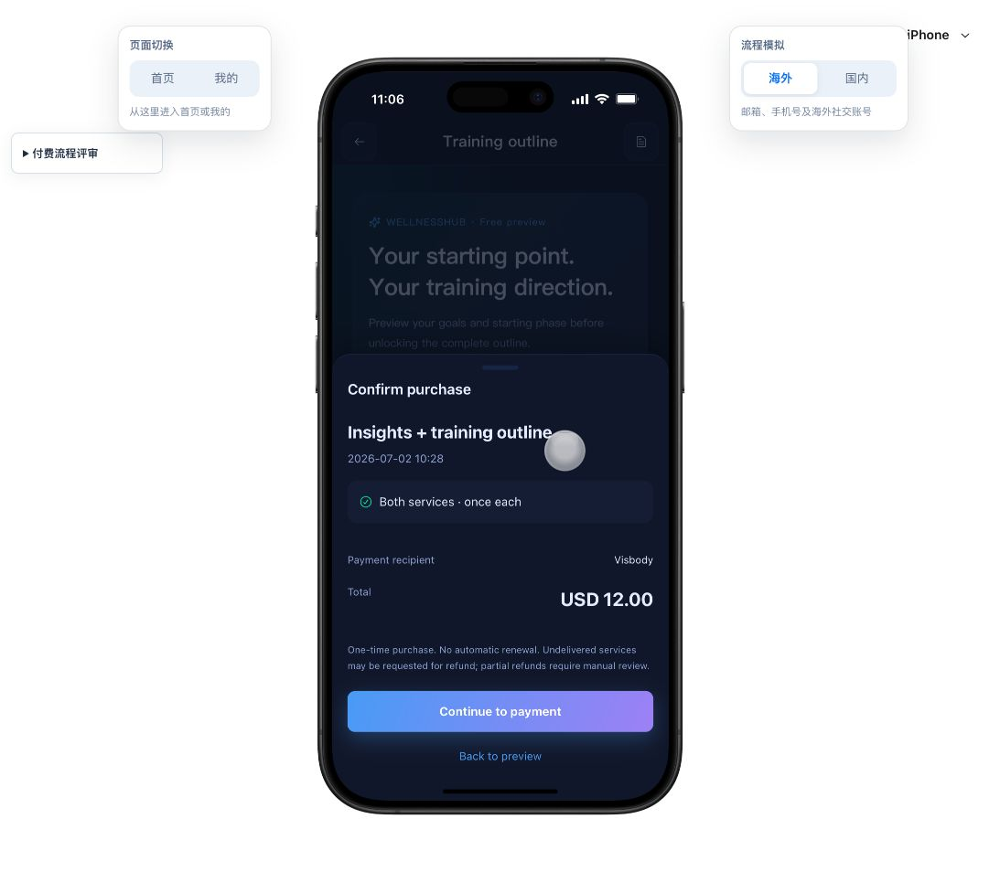

### 用户订单列表与详情

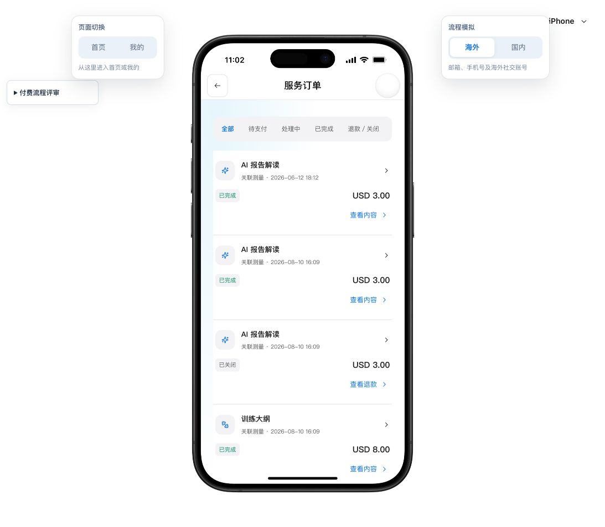

筛选为“全部、待支付、处理中、已完成、退款／关闭”，订单归属仍仅当前用户。列表优先展示服务名、测量日期、金额和用户能理解的状态；提供继续支付、查看进度、查看内容、查看退款。无结果显示空状态，不造占位订单。

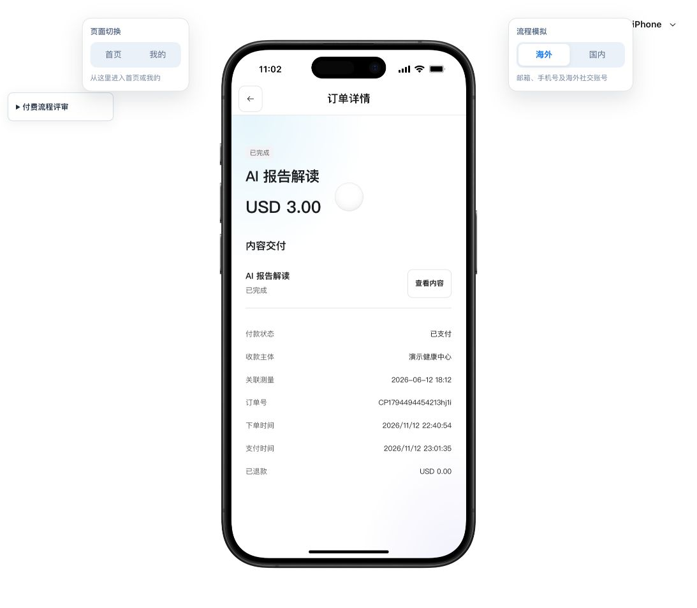

详情将付款状态与内容交付分开，组合两项分别显示状态和操作。订单号、主体、时间、退款信息在详情展示；正常用户页面不出现测试控制或积分内部键值。到期当前不支持在线申请退款，退款中不能继续生成；部分交付保留成功项，退款金额由人工审核。

手机外评审工具控制场景、支付／生成结果、摘要失败及档案缺失。完整训练结果沿用原版阶段与动作条目展示方式；模拟内容不代表真实 AI 处方。原始健康数据权限、正式支付渠道、真实 AI 和生产发布不在本次范围。

## 三端订单与退款

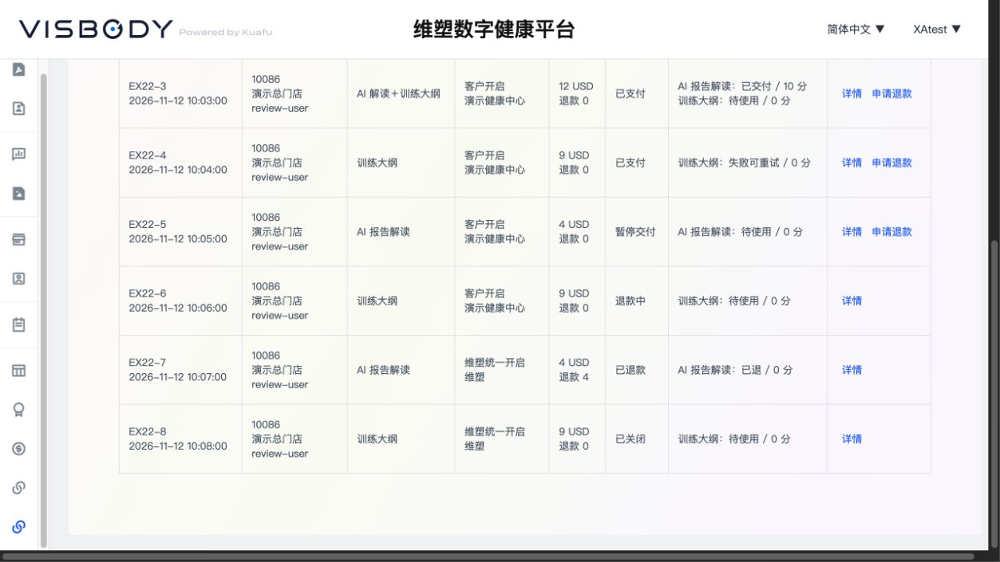

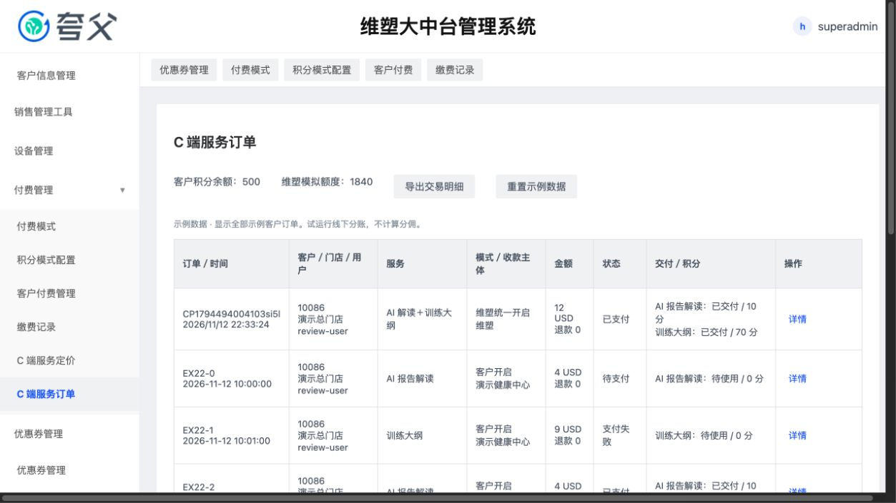

大中台显示全部示例客户；Hub 只显示当前客户；H5 只显示当前用户。关闭收费或 Pro 到期后仍可查询历史。B 端缴费记录继续记录 B 套餐购买，不与 C 服务订单混淆。

列表及详情包括订单号、客户／门店／用户、报告、商品、模式、主体快照、实付金额／币种、支付时间、交付子项、退款及积分流水。支付状态和交付状态独立，组合两项独立交付。

- 待支付／支付失败：条件有效时继续支付。
- 已付待交付／生成失败：继续使用或免费重试。
- 已生成：查看结果，不再生成、收费或扣分。
- 到期暂停：解释原因，提供退款申请；隐藏继续生成。
- 退款中：展示审核状态，锁定申请涉及的未交付服务；重复申请不新增记录。
- 已退款／已关闭：保留记录，不发新权益。

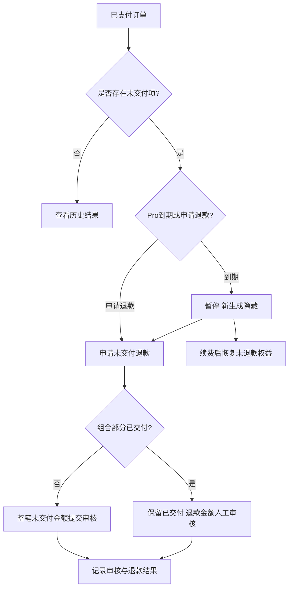

当前不支持在线申请退款，已移除三端申请入口；真实渠道退款、人工后台审批及部分退款执行未接入。预置已退款数据用于展示结果，不能把提交申请直接标记为已退钱。退款时限、争议退款及实际退款渠道能力需上线前确定。

## 通用积分、幂等与模拟数据

能力扣分继续读取现有通用积分配置，不依据误发截图批准分值。成功生成逐项扣分，失败不扣；组合购买预留两项所需额度。客户模式从 B 客户池扣，维塑模式使用单独标记的模拟额度。付款不充值积分，不新增 C 端积分包或钱包。

支付与积分流水分开，关联原订单和服务项；重复下单、支付回调、生成回调均去重。额度不足在付款前阻止下单；支付后服务故障保留已付权益，不要求重新付款。Demo 使用 localStorage，生产必须由后端事务、鉴权和任务补偿保证一致性。

预置 10 条订单，覆盖两种运营模式和售卖方式，以及待支付、支付失败、已交付、部分交付、生成失败、到期暂停、退款中、已退款、已关闭。另一个示例客户的数据只出现在大中台。

示例首次初始化写入，刷新不重复生成；已成功服务与扣分流水相符。“重置预置订单示例”只恢复预置记录及对应流水，保留手动创建订单，不修改个人资料。

### 优惠券使用记录 · 积分发放

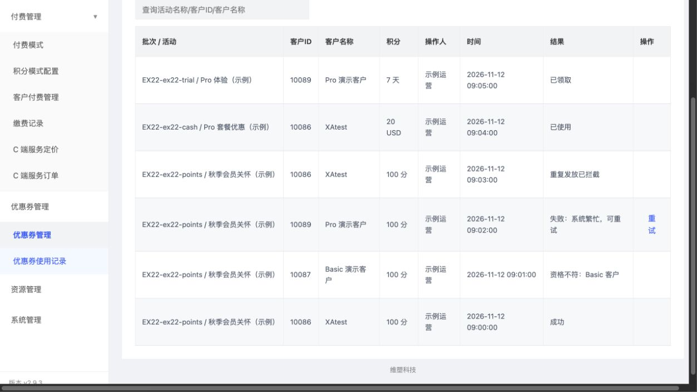

活动积分继续从优惠券管理新建／编辑和发放，客户付费详情不提供积分发放。沿用活动名称、有效期、数量、对象选择、确认和记录；积分类型填写每位客户正整数额度。发放时复核有效 Pro、活动状态、有效期和剩余份数。

“重置活动示例”经过二次确认，只恢复预置活动、记录及对应积分，不删除手动新建活动。

预置成功、Basic 资格不符、系统繁忙待重试、重复发放拦截，以及代金券已使用、体验券已领取记录。成功积分入共享积分池，记录活动、客户、积分、操作人、时间和结果。失败可重试，同活动同客户成功只入账一次；资格不符及重复拦截不增加余额。代金券、体验券不会作为积分扣增，也不会自动成为 C 端支付优惠。

## 线下分账与导出

维塑模式试运行由财务线下分账，无分佣基数、比例和自动打款。导出订单、客户／门店、商品、模式、收款主体、实付币种、退款和支付状态时间；详细交付及积分通过订单查询。Hub 导出仅限本客户，大中台包含全部示例客户。不同币种分开处理，不把客户自收款计入维塑分账收入。

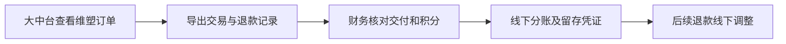

## 存量与版本兼容

存量客户默认关闭新增收费，保留原 B 端积分及已生成结果。收费关闭不能理解为无限免费服务。旧订单保留价格及主体快照，Pro 到期暂停未交付但不注销权益；续费恢复，退款按订单处理。

v2.2.0 完整源码已归档并带 SHA-256；本次 v2.3.0 沿用原三栏文件名便于访问，MD 与 HTML 正文新建版本文件，旧文档不覆盖。H5 原版 v0.2.20 归档后升至 v0.2.21。回退先备份当前工作，在新目录解压核对，不改写历史快照。

## 验收要求与上线前确认

- 三种模式显隐、客户开关展开、必填校验、取消恢复、关闭保留值应全部通过。
- 到期新购买和生成被拦截；已生成查看不受影响；未交付可退款申请、续费可恢复。
- 普通 H5 主页完成训练／解读引导、确认、收银台、支付成功／失败／取消、生成成功／失败重试和订单恢复。
- 组合第二项不重复收费，重复回调不重复扣分；退款处理中不能继续使用未交付项。
- 大中台／Hub／H5 范围正确；示例初始化和重置幂等，手动订单保留。
- 回归优惠券积分发放、代金券、体验券与原 B 端入口；运行时完整性、类型检查、构建和业务测试应通过。

待确认：首期正式售卖方式、维塑积分来源及有效期、真实支付渠道及结算接入、完整训练健康问卷、权益长期有效期、主动再生成与退款时限。以上不以 Demo 假定替代决策。

## v2.3.0 验收与回退

检查普通我的入口、不同报告、取消／失败／刷新恢复、组合两项、免费摘要不扣分、成功只扣一次、Pro 到期、历史结果与退款边界。检查 iPhone／Android、四种已有语言和深浅主题下的安全区、弹层、长文与金额。真实页面截图仅证明本地模拟效果，不代表支付或 AI 已接入。

修改前 v2.2.0 及 H5 v0.2.20 已完整归档，见版本回退说明。新订单与摘要采用兼容存储；回退前另行备份浏览器演示数据。不推送 Git，不改线上配置。

## 最新修订

2026-11-13 修订：发放结果归属优惠券使用记录，菜单与页签独立选中；当前不支持在线申请退款，三端移除申请按钮。历史退款状态只作记录展示，旧退款申请流程不再作为本期实现。
