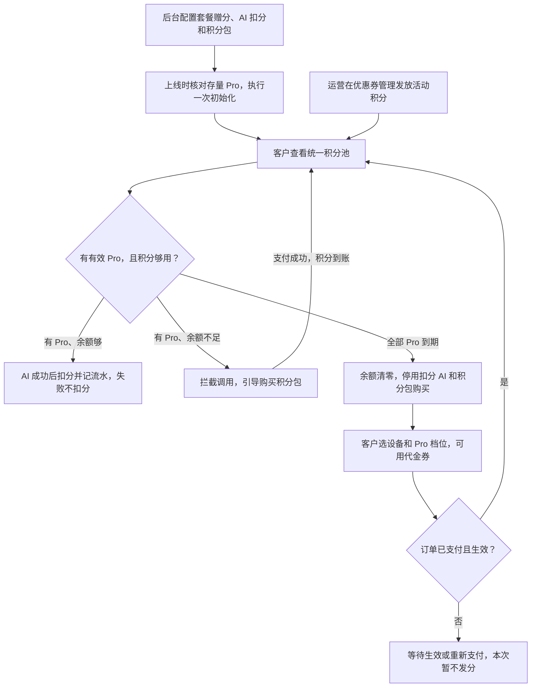
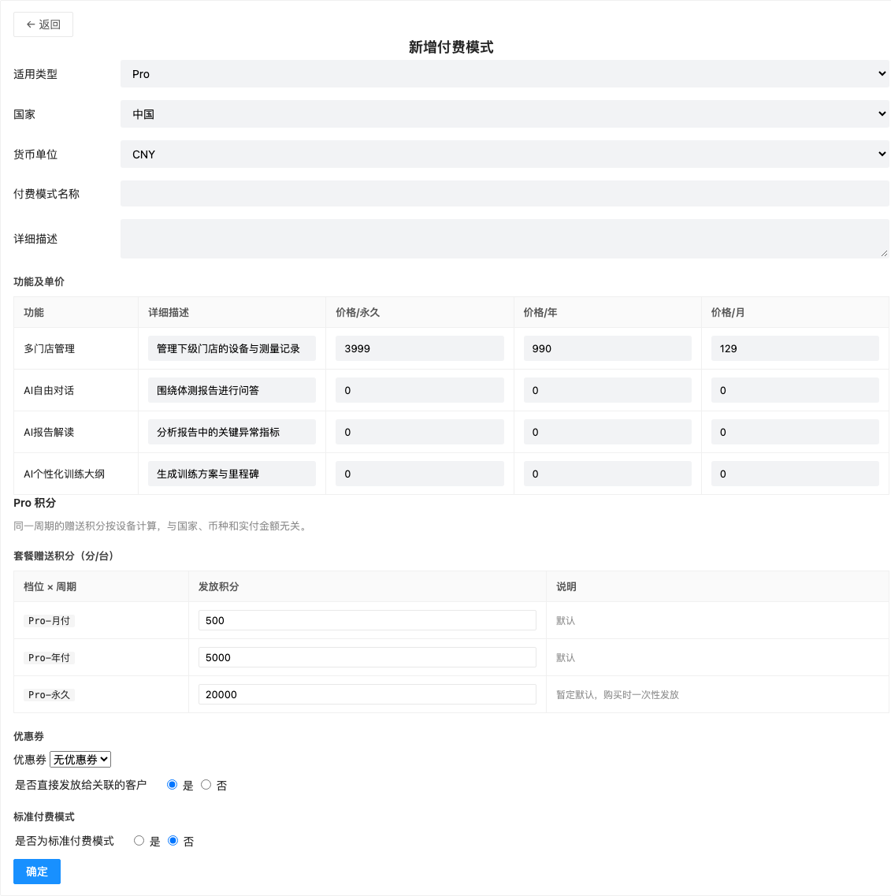
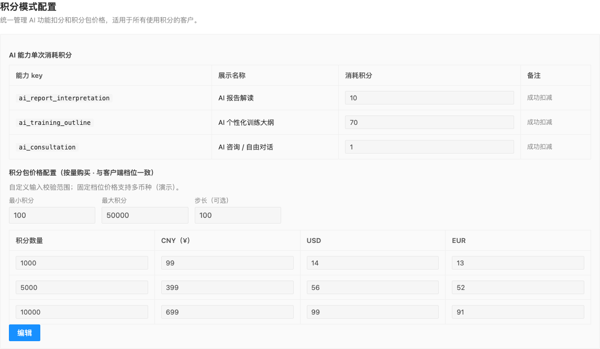
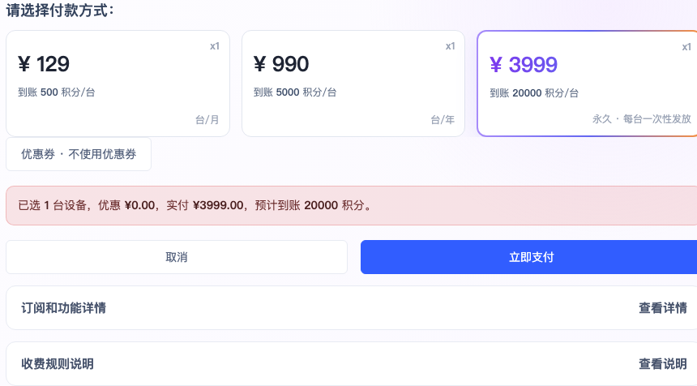
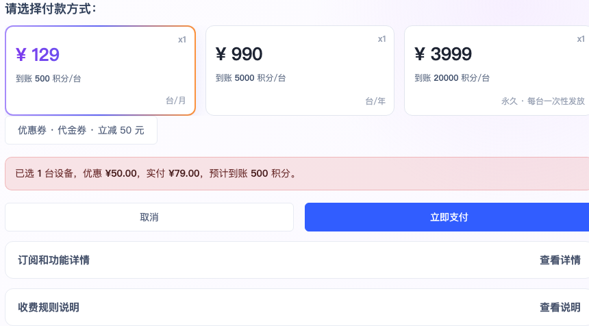
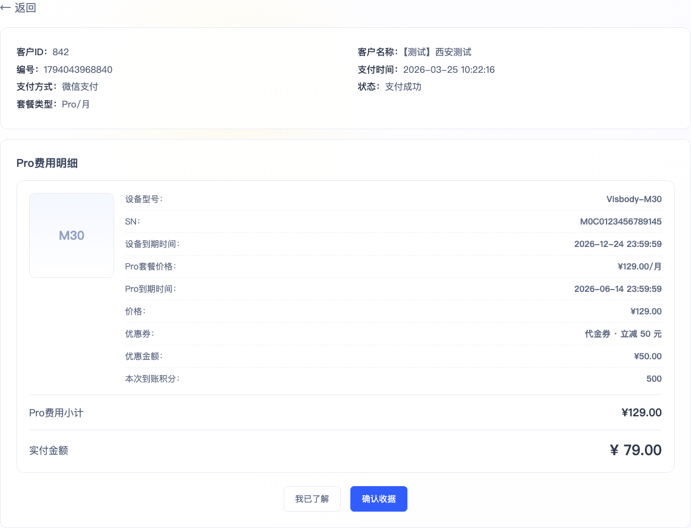
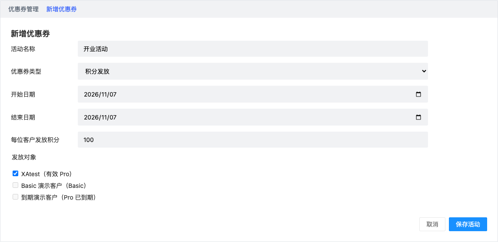
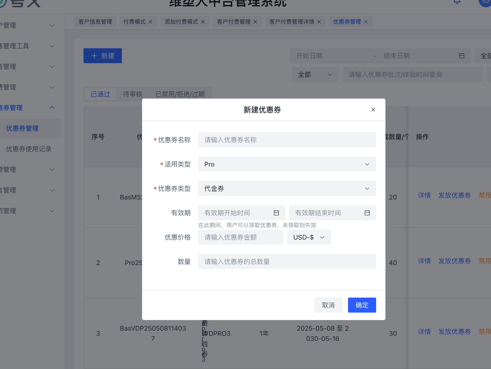

# WellnessHub Pro 积分计费

## 业务流程

客户总门店使用一个积分池，有权限的子门店共用余额。客户在「我的套餐」查看余额与有效期，在「积分使用记录」查看使用和到账记录，在「缴费记录」查看订单明细。

## 上线初始化

以下为迁移方案。折算取整、历史永久档初始额度和有效期须在执行迁移前确认。

| 上线时的设备权益 | 初始化处理 |
|---|---|
| 有效月付／年付 | 按设备计算「该档每台赠分 × 当前付费周期剩余时长 ÷ 该周期总时长」，再汇总到所属客户。Demo 按设备向下取整，月付剩 15 / 30 天发 250 分。 |
| 已到期／Basic | 不发套餐积分。 |
| 仍在免费体验期 | 按剩余体验天数核算独立体验额度，随体验期结束失效。 |
| 历史永久 Pro | 单列待确认。新购永久档的暂定赠分为 20,000 分／台，历史初始化额度另行确定。 |

以上线时点为界，预览客户、设备、权益周期和预计发放量，核对后入账。已生效的存量周期走初始化，跨上线时点尚未生效的订单在生效后走订单发放。每个设备权益周期只归属一种发放路径。初始化以客户、设备及权益周期去重，重跑仅补写漏项。入账记录「上线初始化」及对应权益来源。

上一版截图（仅供历史对照，当前页面见三栏 Demo）

## 后台配置

- **付费模式 → 编辑。** 按周期配置套餐赠分。月付默认 500 分／台，年付 5,000 分／台，永久暂定 20,000 分／台，购买时一次性发放。相同档位采用统一赠分规则，付费价格沿用现有国家、币种与阶梯折扣规则。
- **积分模式配置 → 编辑。** 默认只读。有积分配置权限的运营人员可以编辑、保存或取消。这里统一维护 AI 扣分与积分包价格。AI 默认报告解读 10 分、训练大纲 70 分、自由对话 1 分。积分包按档位和币种配置价格，并可配置自定义额度校验范围。客户端 Demo 演示固定档位购买。
- 保存后新订单和新发起的 AI 请求使用新规则。已确认订单保存价格、优惠及赠分快照，按快照入账。取消编辑恢复已保存的值。

上一版截图（仅供历史对照，当前页面见三栏 Demo）

上一版截图（仅供历史对照，当前页面见三栏 Demo）

## 下单、用券与积分到账

1. 客户在「我的套餐」选设备、周期和优惠券，确认页并列展示优惠额、实付与预计到账。**代金券减价不减分**。赠分按「该档每台赠分 × 对应设备数」计算。两台月付使用代金券后仍获 1,000 分。
2. 支付成功且订单生效后，积分入账一次。失败或待生效时不入账，重复支付回调不重复发放。全额抵扣订单以现有订单系统确认结算成功并生效为触发条件，该分支需接入后验收。
3. 订单详情展示优惠券、优惠额、实付和实际到账积分。余额同步更新。
4. 免费体验券按固定天数、以 2,000 分／月折算独立体验额度，体验期只扣这笔额度。折算取整待确认。时间券延长对应权益期限，赠分仍按所购档位计算。

上一版截图（仅供历史对照，当前页面见三栏 Demo）

上一版截图（仅供历史对照，当前页面见三栏 Demo）

上一版截图（仅供历史对照，当前页面见三栏 Demo）

上一版截图（仅供历史对照，当前页面见三栏 Demo）

## 使用、补购与活动发放

- **AI 扣分。** 发起前校验权益与余额，成功后扣减并记流水，失败可重试。余额不足展示当前余额、所需积分和购买入口。有效 Pro 客户可主动购买积分包，支付成功即到账，Pro 到期时间沿用原权益。
- **活动发放。** 优惠券管理 → 新建积分发放 → 审核通过 → 独立发放页选客户 → 确认 → 后台记录与客户端到账。仅有效 Pro 客户可发，成功立即进入统一积分池，不需要领取、不延长 Pro、不生成支付订单。

### 优惠券管理：积分发放类型

新建沿用现有居中弹窗，客户选择移到独立发放页面。

| 字段 | 规则 |
| --- | --- |
| 优惠券名称 | 必填；到账记录显示该活动名称。 |
| 适用类型 | 固定 Pro。 |
| 优惠券类型 | 新增积分发放；保留代金券与免费体验券。 |
| 有效期 | 起止时间必填，开始不得晚于结束；限制运营发放时间，到账后积分沿用积分池有效期。 |
| 每位客户发放积分 | 正整数，替换优惠价格，不显示币种；首次成功发放后锁定类型与额度。 |
| 数量 | 正整数，一份对应一位客户；总数量不可小于已成功发放份数。 |

独立发放页沿用批次、客户 ID／名称／账户名搜索、国家筛选和客户表格。积分类型每客户固定一份，展示每人积分、剩余份数、Pro 状态与不可发原因。确认前展示目标人数、已发人数和预计新增积分总量。

- 提交复核审核状态、活动期限、禁用状态、Pro 资格及剩余份数。
- 同一活动与客户只入账一次。处理中预占份数，成功占用、失败释放；生产系统原子更新份数和积分账本，不能仅用前端禁用按钮防重。
- 在「优惠券使用记录」查看积分发放记录：批次、活动、客户、积分、操作人、时间、结果。失败可单独重试，重新校验；已成功记录及余额保持不变。
- Demo 仅模拟审核、编辑后回待审核。真实审核权限与重审机制须沿用现有系统，尚未完成细则核对。
- 客户付费管理只维护 Basic／Pro 权益状态；套餐赠分仍由订单结算且生效触发，上线初始化保留在评审文档独立模块。

客户端保留现有 WellnessHub 品牌栏、导航与套餐设备列表，仅增加余额及到账表格。活动到账显示来源、活动名、到账时间、积分。代金券减价不减分，体验券独立额度规则不变。

- **到期。** 有任一有效 Pro 时账户积分可用。全部到期后清零，停用耗分 AI 和购买积分包，续费生效后重新发分。Demo 暂按永久 Pro 可维持积分池演示，正式有效期规则待确认。

上一版截图（仅供历史对照，当前页面见三栏 Demo）

上一版截图（仅供历史对照，当前页面见三栏 Demo）

## 验收场景

| 场景 | 预期结果 |
|---|---|
| 编辑扣分规则后取消，再次打开 | 显示原配置。保存后新操作读取新值。 |
| 月付剩一半，初始化重复执行 | 同一权益周期只入账 250 分。跨上线待生效订单由订单路径发放一次。 |
| 活动发放 100 分 | 有效 Pro 客户到账 100 分，后台可查发放记录，客户端可查活动名称与到账时间。重复提交保持余额，失败可重试。 |
| 单台月付 ¥129，使用 ¥50 代金券 | 实付 ¥79，订单生效后到账 500 分，预览、订单与余额一致。 |
| AI 失败、积分不足、全部 Pro 到期 | 分别验证失败不扣、余额不足拦截并可补购、到期清零后可续费恢复。 |

## 本次视觉与验收基线

2026-11-07 已只读核对真实后台优惠券列表、新建弹窗、独立客户发放页，以及客户端我的套餐页面；未在真实系统新建、审核或发放。记录页及审核权限细则尚未完成现场核对。双端 Demo 使用同源模拟账本。三栏中间以 1440px 桌面视口嵌入，提供适应宽度、100% 和全屏查看，不触发移动导航。

验收增加：100 分 × 20 份最多发给 20 位；未审核、禁用、过期均不可发；重复提交不扣份数；失败后重试不重复到账；首次发放后锁定额度；客户端余额和活动来源同步。

当前可操作页面以[三栏评审文档](./付费模式-完整需求文档.html#admin-grant)为准。下图为用户提供的真实大中台基线，非新版 Demo：

