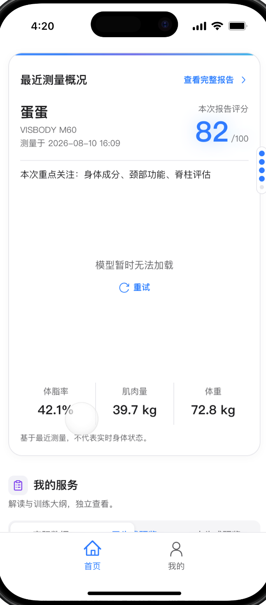
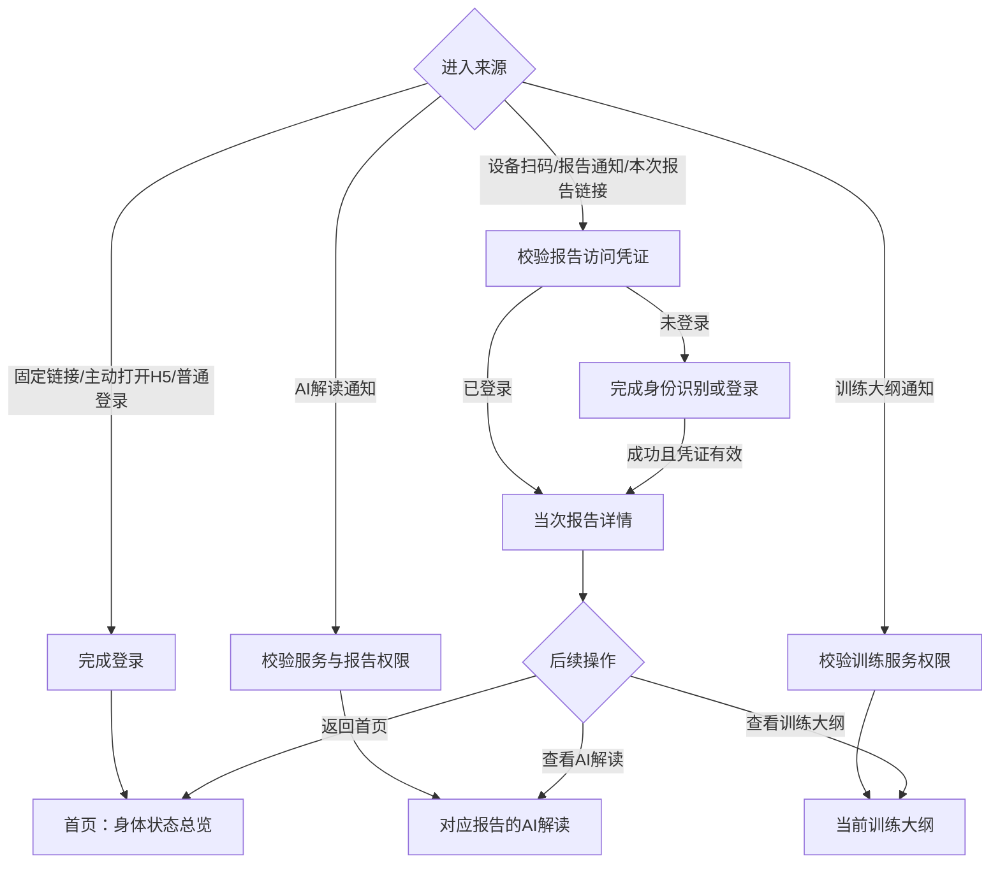

# WellnessHub H5 首页纵向综合总览 PRD

本文定义 WellnessHub H5 首页由“最近一次报告摘要”升级为“多次测量后的身体状态与服务总览”的产品规则，供产品、设计、客户端、服务端、算法与测试共同使用。本文只定义首页及与首页入口直接相关的跳转，不修改单次测量报告内部结构。

## 需求结论

- 设备测量完成、扫码或点击报告生成通知后，用户应进入凭证绑定的当次报告详情，不先经过首页。
- 用户通过固定链接、主动打开 H5 或普通登录进入产品时，进入首页。
- 单次报告回答“这一次测得怎么样”；首页回答“最近多次测量发生了什么变化、哪些问题需要持续处理、下一步应做什么”。
- 首页默认统计最近 7 个测量批次，并显示这 7 次实际覆盖的起止日期。7 次是展示窗口，不是医学判断周期。
- 每个模块独立读取该模块最近的有效、可比记录；未测量不等于正常，也不得补零或参与趋势。
- AI 报告解读按报告判断状态；个性化训练大纲按用户当前服务判断状态，二者互不依赖。

## 当前页面与改造目标

当前首页以最近一次测量为核心，首屏重复展示当次报告评分、重点关注、3D 模型、体脂率、肌肉量和体重。用户刚完成测量时仍需再点击“查看完整报告”，与其“立即查看本次结果”的意图不一致。



上图仅作为当前页面基线，不代表新版目标视觉。新版保留现有模块的整体层级与语义图标体系，但改变各模块的数据范围和职责：最近报告信息下沉，首页首屏改为多次测量的阶段结论。

## 用户与使用场景

本需求面向 C 端已注册用户。游客仍只能查看二维码绑定的本次报告，不进入个人纵向首页。

主要场景：

- 用户刚完成一次设备测量，希望立即查看这次报告。
- 用户过一段时间重新打开 H5，希望确认身体状态是否改善。
- 用户在不同测量批次只完成部分项目，希望知道哪些项目有更新、哪些需要复测。
- 用户希望查看 AI 解读、当前训练大纲及训练是否需要更新。
- 用户曾使用不同设备，希望看到正确的数据范围，不被不可比数据误导。

## 入口与跳转流程



跳转规则：

- 带报告上下文的入口必须保留服务端校验后的 `reportId`；登录成功后仍进入该报告，不得改跳首页或自动取最新报告。
- 固定入口不携带 `reportId`，登录成功后进入首页。
- 报告不存在、凭证失效或用户无权访问时，不得回退为“最近报告”，应展示对应错误并提供返回首页或重新扫码。
- AI 与训练通知仅在对应内容已生成且用户有查看权限时直达；否则展示真实服务状态。

## 核心数据定义

### 测量批次

一次到店或一次设备测量任务形成一个测量批次。批次至少包含：

- 批次标识。
- 测量时间。
- 设备型号与设备族。
- 本批次实际完成的模块列表。
- 各模块对应的报告或结果标识。

同一批次可能只完成设备支持模块的一部分。

### 设备能力

设备能力表示某个型号“支持测量什么”，不能用于判断用户“实际测量了什么”。例如 M60S 可支持：

- 身体成分。
- 体态。
- 体围。
- 脊柱评估。
- 肩部评估。
- 颈部评估。
- 平衡评估。
- 红外评估。
- 体征评估。

实际支持范围以正式设备能力矩阵为准；前端不得写死所有设备均支持上述 9 类项目。

### 模块记录

模块记录是某个批次中真实完成的一类测量。至少包含：

- 模块类型。
- 来源批次和来源报告。
- 测量时间。
- 设备型号或可比设备族。
- 指标定义版本、算法版本和单位。
- 模块结果、风险等级和完整性状态。

### 可比记录

只有满足以下条件的记录才能连接为数值趋势：

- 用户一致。
- 模块一致。
- 设备型号一致，或已由业务与算法确认属于同一可比设备族。
- 指标定义、算法版本和单位兼容。
- 记录有效且不是未完成、失败或人工废弃状态。

不同设备、不同指标定义的结果可以分别展示，但不得直接平均、相减或连接成同一趋势。

## 首页信息结构

新版首页由以下模块组成：

1. 身体状态总览。
2. 核心指标变化。
3. 我的服务。
4. 需要关注与已有改善。
5. 形态变化。
6. 历史趋势。
7. 最近报告入口。

首页不再首屏重复展示最新报告的姓名、设备、单次评分、单次异常摘要和单个 3D 模型。

## 身体状态总览

身体状态总览位于首页第一屏，默认使用当前主设备流的最近 7 个有效测量批次。

### 展示内容

- 标题：`身体状态总览`。
- 统计范围：`最近 {实际批次数} 次测量`。
- 起止日期：最早批次日期至最近批次日期。
- 覆盖摘要：`覆盖 {已测模块数}/{设备支持模块数} 类测量项目`。
- 阶段摘要：改善项、持续关注项和新增关注项的数量。
- 操作：`查看阶段详情`。

示例：

> 最近 7 次测量 · 2026/02/15—2026/08/10  
> 覆盖 7/9 类测量项目  
> 3 项改善 · 2 项持续关注 · 1 项新增关注

### 统计范围规则

- 有 7 次及以上有效批次：展示最近 7 次。
- 有 2—6 次有效批次：按实际次数展示。
- 只有 1 次：展示“首次测量”，不生成阶段摘要和趋势结论。
- 没有测量：展示空状态和设备测量引导。
- 7 次跨度无论是一周、数月还是更长时间，都显示实际起止日期，不将其描述为周报或月报。
- 首页不提供统计次数切换；完整历史和更多筛选进入阶段详情或历史页面。

### 测量覆盖规则

- 分母来自当前设备型号正式支持的模块数。
- 分子为最近 7 个测量批次内至少出现过一次有效记录的模块数。
- “本次未测”“最近 7 次未测”和“设备不支持”必须是不同状态。
- 覆盖摘要点击后展开模块列表，显示模块名称、覆盖次数和最近有效测量日期。

示例：

| 模块 | 最近 7 个批次覆盖 | 最近有效测量 |
| --- | --- | --- |
| 身体成分 | 7/7 次 | 08-10 |
| 体态 | 5/7 次 | 08-10 |
| 体围 | 4/7 次 | 08-10 |
| 脊柱评估 | 3/7 次 | 07-20 |
| 肩部评估 | 2/7 次 | 06-18 |
| 颈部评估 | 3/7 次 | 08-10 |
| 平衡评估 | 1/7 次 | 05-11 |
| 红外评估 | 0/7 次 | 尚未测量 |
| 体征评估 | 2/7 次 | 07-20 |

首页只显示覆盖摘要和少量高频模块，完整表在展开层或阶段详情中展示，避免 9 个以上模块挤占第一屏。

## 核心指标变化

核心指标不再只显示最近值，而是显示当前值、较上次变化和阶段变化。默认指标仍为体脂率、肌肉量和体重；设备不支持或没有有效记录时不占空卡位。

### 展示规则

- 当前值：该指标最近一次有效、可比记录。
- 较上次：与上一条可比记录比较。
- 阶段变化：与当前首页统计流中最早一条可比记录比较。
- 每项都显示当前值来源日期。
- 点击指标进入该指标完整趋势，不进入最新报告的单项详情。

示例：

| 指标 | 当前值 | 较上次 | 阶段变化 |
| --- | ---: | ---: | ---: |
| 体脂率 | 22.6% | -0.8% | -2.4% |
| 肌肉量 | 39.7 kg | +0.3 kg | +1.1 kg |
| 体重 | 72.8 kg | -0.4 kg | -2.1 kg |

### 数据不足

- 1 条记录：只显示当前值和日期，文案为“完成下一次同类型测量后可查看变化”。
- 2 条及以上：可显示前后差值。
- 不得仅依据体重下降推断脂肪减少，也不得根据某一项变化生成健康诊断。

## 我的服务

AI 报告解读和个性化训练大纲继续独立展示，但改为符合其真实业务归属。

### AI 报告解读

AI 解读按报告绑定：首页展示最新报告对应的解读状态。

- 已生成：显示来源报告日期、最多两行摘要和“查看解读”。
- 最新报告未生成，但有历史解读：明确显示“历史解读”，不得冒充最新结果。
- 未生成或无权限：显示服务说明；是否展示购买或生成入口由后续权益与付费配置决定。
- AI 解读不作为训练大纲的前置条件。

### 个性化训练大纲

训练大纲按用户在当前门店的长期服务展示：

- 当前是否存在有效大纲。
- 当前阶段和训练周期。
- 本周完成进度。
- 最近更新时间。
- 最近测量后是否出现需要更新大纲的新问题。

示例：

> 当前处于第 2 阶段 · 本周完成 2/4 次  
> 最近测量新增颈部关注项，建议更新训练大纲

AI 与训练的真实可见性受 B 端开通、C 端购买、内容是否已生成及门店权限影响；基础报告始终可查看，已生成内容不得重复收费。

## 需要关注与已有改善

首页不直接复制最新报告的异常列表，而是按模块最近有效记录和历史变化生成状态。

### 状态定义

| 状态 | 触发条件 | 首页表达 |
| --- | --- | --- |
| 持续关注 | 同一模块最近至少 2 次有效记录均处于关注或重点关注 | `{模块}连续{次数}次需要关注` |
| 本次新增 | 模块最近一次异常，上一条可比记录正常 | `{模块}出现新的关注项` |
| 已有改善 | 最近一次风险等级优于上一条可比记录 | `{模块}较上次已有改善` |
| 持续良好 | 至少 3 次有效记录保持良好 | `{模块}连续{次数}次保持良好` |
| 暂无新数据 | 历史存在关注项，但最近多个总批次未复测该模块 | `{模块}上次存在关注项，近期未复测` |

### 排序与数量

首页默认最多展示 3 个需要关注项，排序优先级为：

1. 风险程度更高。
2. 连续出现次数更多。
3. 最近仍在恶化。
4. 会影响当前训练方案。
5. 测量日期更新。

已有改善和持续良好结果默认折叠，最多展示 2 项摘要。完整结果进入阶段详情。

### 判定门槛

- 0 次有效记录：尚未测量。
- 1 次：只展示最新状态，不判断变化。
- 2 次：可判断较上次改善、恶化或持平。
- 3 次及以上：才可使用“持续改善”“持续关注”“持续良好”等纵向文案。
- 某批次没有测该模块，不影响它已有记录的连续顺序，也不能作为正常结果参与判断。

## 形态变化

当前首页单个 3D 模型下沉到报告详情；首页仅在存在至少两次可比模型时展示“形态变化”。

### 可比模型状态

- 至少 2 个可比模型：展示首次/最近切换、测量日期和“查看完整 3D 对比”。
- 只有 1 个模型：显示紧凑提示“完成下一次同类型测量后，可查看身体形态变化”，并提供查看当前报告入口。
- 没有模型或模型加载失败：不保留大面积空白，使用紧凑异常状态和重试入口。
- 模型协议、设备族或算法版本不兼容：分开展示，不进行叠加或差值计算。

## 历史趋势

首页趋势模块保留综合评分、体脂率、肌肉量和体重，并支持后续加入用户重点关注指标。

### 统计口径

- 首页总览范围是最近 7 个测量批次。
- 单个模块或指标的趋势读取“该模块最近 7 条有效、可比记录”，因此可能跨越超过 7 个总批次。
- 趋势标题必须写明真实数量，例如“最近 3 次颈部评估”，不能统一写成“近 7 次”。
- 每个节点可进入对应来源报告。
- 被排除的不同口径记录应给出提示“部分记录因设备或测量口径不同，未并入趋势”。

### 趋势文案

| 数据状态 | 页面文案 |
| --- | --- |
| 0 条 | 暂无该项测量数据 |
| 1 条 | 完成下一次同类型测量后可查看变化 |
| 2 条 | 较上次增加/减少/持平 |
| 3 条及以上同向变化 | 最近 {次数} 次持续改善/持续变化 |
| 结果上下波动 | 最近结果存在波动，请结合测量条件查看 |
| 存在不可比记录 | 部分记录因设备或测量口径不同，未并入趋势 |

“持续改善”必须同时满足业务定义的改善方向，不能只根据数值上升或下降判断。例如肌肉量增加可能为改善，体脂率增加通常不是改善；具体方向由指标配置提供。

## 最近报告入口

最近报告作为首页尾部或阶段摘要中的次级入口，不再占据第一屏主要空间。

展示：

- 最近报告日期。
- 设备型号。
- 本次实际完成的模块数量。
- `查看最近报告`。
- `全部评估记录`。

首页中的阶段结论跳转阶段详情；最近报告入口只负责打开最近一次完整报告。

## 多设备兼容

用户可能在不同设备上测量。首页按“设备数据流”组织：

- 默认选择最近一次有效测量所属的设备族。
- 存在多个设备流时，在阶段详情提供设备切换；首页首屏不把多个设备的数值强行汇总。
- 跨设备可以合并展示测量次数、模块覆盖和已标准化的风险分类。
- 跨设备不得直接合并综合评分、具体数值趋势、体围变化或 3D 模型，除非正式兼容矩阵明确可比。
- 用户切换设备流后，统计范围、覆盖模块、关注项和趋势同步刷新。

## 页面状态

### 无测量

- 标题：`还没有测量记录`。
- 说明：`在设备上完成测量后，扫码查看报告。`。
- 操作：`查看评估记录`或设备测量引导。
- 不展示趋势、持续关注或服务已生成假数据。

### 首次测量

- 标题：`首次测量`。
- 展示当前模块覆盖、最新有效结果和最近报告入口。
- 不展示持续、改善或恶化结论。
- AI 和训练按真实服务状态展示。

### 两次可比测量

- 可展示前后差值、新增关注和已有改善。
- 不使用“持续改善”“长期稳定”等文案。

### 三次及以上

- 可展示持续关注、持续改善、波动和阶段趋势。
- 仍需满足同设备、同模块和同指标口径要求。

### 数据读取失败

- 报告列表失败：不使用缓存示例替代真实结果；显示“身体状态读取失败”和重试。
- 单模块失败：其他模块正常展示，失败模块显示局部重试。
- 服务状态失败：不将已有服务误判为未生成；显示“服务状态暂时无法读取”。

## 数据接口建议

服务端建议提供首页聚合接口，避免各客户端分别实现复杂规则。返回结构至少包括：

```text
summaryWindow
  batchCount
  startDate
  endDate
  activeDeviceFamily

moduleCoverage[]
  moduleId
  supported
  measuredBatchCount
  latestMeasuredAt
  latestReportId

progressSummary
  improvedCount
  persistentConcernCount
  newConcernCount

metricTrends[]
  metricId
  comparisonKey
  points[]
  excludedCount

findings[]
  moduleId
  status
  occurrenceCount
  latestMeasuredAt
  sourceReportId

latestReport
latestAiInterpretation
activeTrainingOutline
comparableModelPair
```

服务端必须返回结论的来源记录和计算版本。客户端只负责展示，不自行跨设备合并或重新解释风险等级。

## 权限与套餐

- 基础测量报告和基础历史记录不因 AI/训练权限而隐藏。
- AI 解读和训练大纲属于独立服务，按内容生成状态和权益来源分别判断。
- B 端已生成的服务内容，C 端可以直接查看，不重复收费。
- B 端配置为 C 端付费时，只有尚未生成且用户无其他权益的服务才进入付费流程。
- 训练大纲不要求先生成 AI 报告解读。
- 设备不支持、报告数据不足或健康档案不完整时，展示不可用原因，不以购买按钮替代。

## 埋点建议

- 首页曝光：批次数、覆盖模块数、设备流数量，不记录具体健康数值。
- 查看阶段详情。
- 展开测量覆盖。
- 点击核心指标趋势。
- 点击持续关注、新增关注、已有改善。
- 查看 AI 解读、训练大纲及服务说明。
- 查看最近报告、历史报告和 3D 对比。
- 数据不足、口径不兼容、模块读取失败和重试。

埋点不得包含真实姓名、手机号、完整报告内容或可识别的健康数据。

## 验收标准

- 扫码、报告通知和本次报告链接登录后进入绑定报告；固定入口登录后进入首页。
- 首页默认读取最近 7 个有效测量批次，并显示真实起止日期；少于 7 次按实际次数展示。
- M60S 某次只测部分项目时，首页覆盖次数与最近测量日期正确；未测模块不显示为正常或 0。
- 每个模块使用自己的最近有效记录；来源日期与来源报告可追溯。
- 只有 1 次有效记录时不展示趋势；2 次不使用持续性文案；3 次以上才允许持续判断。
- 不同设备或不同指标版本的数据不会连接成同一数值趋势，排除原因有明确提示。
- 最新报告未生成 AI 解读时，不会展示历史解读为最新结果。
- 训练大纲与 AI 解读独立显示，训练入口不依赖 AI 状态。
- 3D 模型不足两次时不展示虚假对比；加载失败不产生大面积空白。
- 删除报告后，首页重新计算，不恢复示例报告或已删除数据。
- 中文、英文、德语、阿拉伯语及 RTL 下动态文案、日期、单位和布局可读。
- 320、375、390、393、423、427px 及 iPhone/Pixel 预览无横向溢出，底部导航不遮挡最后一个模块。

## 分期实现

### 第一阶段：确定性聚合

使用现有报告集合完成：最近 7 个批次、模块覆盖、当前值与前次变化、关注状态、同口径趋势、最近报告和服务状态。该阶段不生成跨报告 AI 结论。

### 第二阶段：服务端纵向摘要

由服务端统一输出持续关注、新增问题、已有改善、设备数据流和结论来源，固化算法版本与可追溯性。

### 第三阶段：跨报告 AI 与训练联动

在用户授权和数据充足时，提供阶段 AI 总结、训练效果评估、目标进度和训练大纲更新建议。该能力与单次报告 AI 解读分开定义、单独判断权益。

## 待确认项

- 最近 7 次是否仅作为系统固定默认值，还是在阶段详情中开放 3／7／12 次等窗口切换；首页首期仍固定为最近 7 次。
- 各设备型号的正式模块能力矩阵及可比设备族配置。
- 身体成分、体态、脊柱、颈部等异构模块映射到“正常／关注／高关注／改善”的标准化规则及责任服务。
- 指标定义或算法升级后，哪些版本可以继续比较。
- 各指标“改善方向”和波动阈值的正式配置。
- “近期未复测”采用相隔批次数还是同时增加最长自然日提示。
- 阶段详情是否首期提供设备切换，还是先按最近设备族展示。
- 第二阶段纵向摘要由报告服务、独立聚合服务还是 AI 服务负责。

以上待确认项不会阻止第一阶段页面结构设计，但会影响持续性结论和正式上线的数据可信度。
