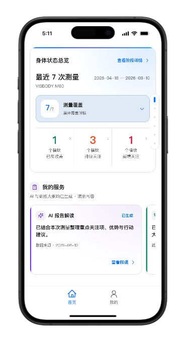
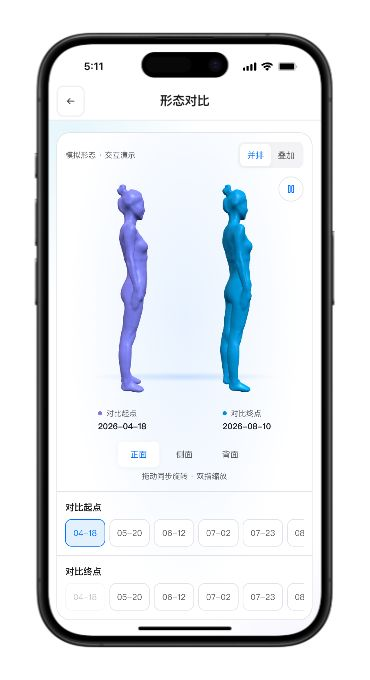
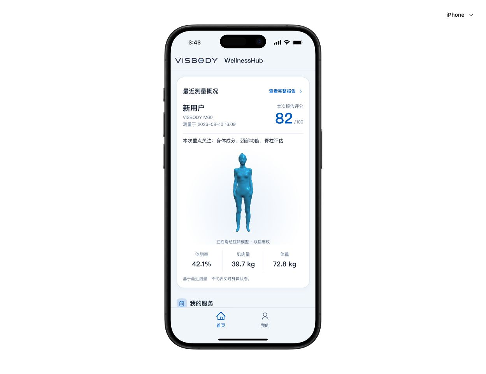
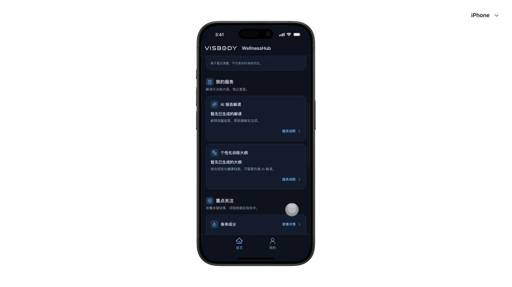
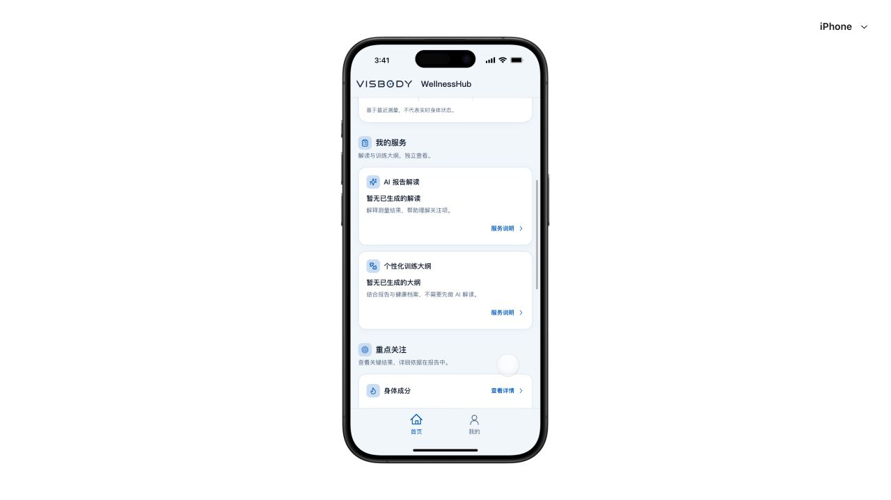
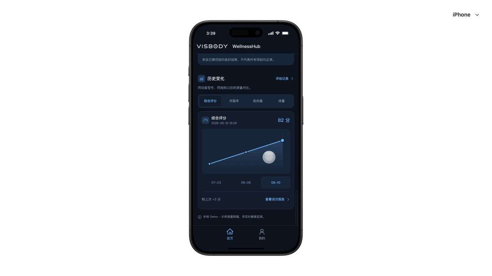
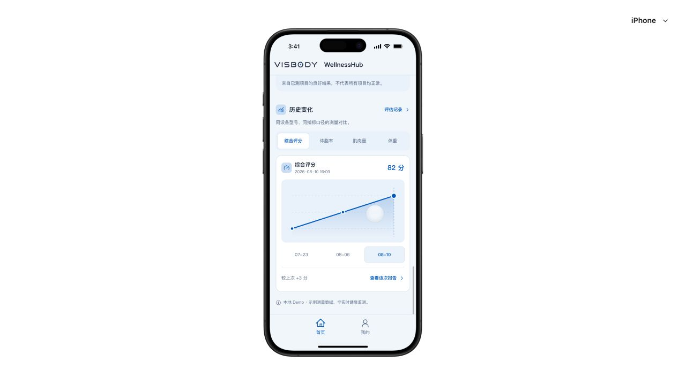

# WellnessHub H5 Design QA

## v0.2.14：首页交互与双次形态模拟（2026-10-15）

- 已实现：顶部三类模块统计可点击进入 `/stage/{filter}`，分类与首页数字一致；逐批测量证据、未测标记、原报告跳转和改善说明完整。
- 已实现：单一指标趋势模块，弹性选项底板、曲线入场、磁吸选点、较上次/阶段变化；体脂差值为百分点。选中07-23肌肉量39.1kg后进入相应报告，返回保留指标、选点及首页滚动，浏览器实点通过。
- 已实现：主Demo AI/训练双生成满态，移除页面调试条和翻卡门槛；两类服务进入只读示例详情，未写个人服务存储。旧隔离预览保留。
- 已实现并目视：双模型实际渲染、并排/叠加、同步视角、日期切换、透明度和暂停/继续控件；首页与 `/shape` 共用组件，单一源资产派生模拟在UI明确标注。
- 动效：首屏数字递增和分层入场、统计按压、详情进入、指标底板弹性移动及曲线绘制；返回不重复首屏数字入场。章节定位只滚动应用容器，避免应用代码调用原生scrollIntoView移动外层手机。
- 自动检查：首页22/22、认证4/4、游客4/4、国内登录6/6、Sites4/4、TypeScript/生产构建、运行时28文件完整性均通过；JS大包约1.19MB告警保留。
- 浏览器代表检查：中文浅色iPhone393、德语深色Pixel427、阿拉伯语深色RTL阶段详情、英文浅色新增详情；静止后main无横向溢出，控制台无错误。语言/主题已经恢复为中文浅色，交付预览为iPhone。
- 自动化点击会把保护运行时的隐藏键盘所在device-screen祖先滚动（浏览器原生焦点/scrollIntoView），本轮未改保护运行时；截图使用新打开、无自动聚焦干扰的预览页。没有将完整真机/320–427全语言矩阵、屏幕阅读器、多指手势或旋转暂停3秒计时列为已通过。
- 截图：`qa/v0.2.14/home.jpg`、`qa/v0.2.14/shape-comparison.jpg`。真实双次扫描、服务生成/支付与后台能力矩阵仍未接入。

## v0.2.3 首页与全局视觉 — 2026-09-18

### 已完成

- 首页「我的服务」增加 Demo 三态切换：实际数据 / 已生成预览 / 未生成预览
- 历史变化固定展示近 7 次测量；区块「查看全部」与趋势卡点击进入 `#/history` 全参数列表
- 浅色「我的」页卡片阴影对齐首页（`--card-shadow`）
- 全局 Icon：中性底 `--icon-bg` + 高饱和 accent 图标色
- 浅色背景 `#ffffff`、深色背景 `#0a0a0a`；移除首页蓝系 token override
- 身体档案：移除体重字段；新用户标题「新用户注册」/ 编辑标题「身体档案」

### Home v0.3 交互方案对比（待选型，本阶段未实现）

| 方案 | 核心体验 | 适用模块 | 复杂度 | 优先级建议 |
|------|---------|---------|--------|-----------|
| A 评分 Hero | 3D 区评分数字 count-up + 指标 chip 弹性展开 | 概况卡 | 中 | 高 — 首屏冲击力强 |
| B 服务 Deck | AI/训练卡片左右滑 + 已生成/未生成 flip | 我的服务 | 中 | 中 — 与三态预览互补 |
| C 趋势 Scrub | 图表拖拽磁吸 + 光带跟随 + 整卡进历史 | 历史变化 | 低-中 | 高 — 改动面小、收益明显 |
| D 分区入场 | section scroll stagger + 滚动指示器 | 全页 | 低 | 低 — 锦上添花 |

**共性约束**：须兼容 `MobileScroll` 纵向滚动、`Carousel` 横向手势；`prefers-reduced-motion: reduce` 下禁用 count-up / stagger / flip，保留静态态与焦点环。

**推荐实施顺序**：C → A → B → D（用户确认后再开独立迭代）。

### 首页 v0.3 统一交互（2026-09-18 已定稿合并）

四套方案已同时并入首页（`home-unified-v3`），不再使用 A/B/C/D 预览切换条：

| 能力 | 行为 |
|------|------|
| A Hero | 进入首页评分 count-up；指标 chip 首次点击展开、再次点击进入详情 |
| B Deck | 我的服务区横向滑切 Carousel；点击卡片 3D 翻转 |
| C Scrub | 历史趋势图横向拖拽磁吸选点 + 光带；底部「查看该次 / 查看全部」 |
| D Reveal | 各区块 scroll stagger 淡入；右侧进度圆点随滚动高亮 |

概况卡顶部渐变色条 + 评分微光为 v0.3 视觉强化。

## v0.2.3 登录页底部按钮重排 — 2026-09-17

### 目标

- 游客体验上提至登录按钮正下方，作为全宽 Secondary CTA，提高可发现性
- 创建新账号降为「还没有账号？创建新账号」文本链接
- … / Google / Facebook / 更多方式统一归入「其他登录方式」同区；**图标圆形按钮横排**，避免全宽竖排占高

### 已完成

- `Auth` DOM：`guest-cta` → `auth-register-row` → `auth-alt-block`（圆形 icon 按钮：Google / Facebook / mode 第三项）
- 删除独立 `AccountChannelSwitch` 与底部孤立「…」方块
- i18n 新增 `noAccount`（zh / en / de / ar）
- CSS：`.guest-cta`、`.auth-register-row`、`.auth-text-link`、`.auth-alt-icons`、`.alt-icon-btn`

### 验收清单

1. 登录下方立即可见「游客体验」全宽 CTA（标题 + 副文案 + chevron）
2. 「创建新账号」为文本链，不再占全宽 secondary
3. 「其他登录方式」下 Google / Facebook / 更多或邮箱验证码同区同宽
4. emailCode / emailPassword / phoneCode / phonePassword 四种 mode 结构正确
5. light ↔ dark 形态一致；BottomSheet 仍可打开
6. `npm run check:runtime` + `npm run build`：通过

## v0.2.2 登录整改 — 2026-09-17

实现完成，流程实点通过；未标记全站正式交付。

- 完整实点：邮箱验证码 → 邮箱密码 → 省略号 → 弹层手机号密码 → 手机验证码 → 醒目邮箱返回。弹层退出动画期间需等待退出后操作下一控件。
- 邮箱／手机号密码的忘记密码固定在逻辑末端；更多不再占用表单辅助行。手机号两页返回邮箱使用同一结构、同一位置。
- 窄屏检查覆盖320、375、390、393、423、427px、四语言与深浅主题，未观察到横向溢出；德语允许换行。Pixel 阿拉伯语主题截图检查完成。批量检查存在即时读取旧模式的时序问题，因此不作为四模式全矩阵验收证据；完整路径另行逐状态等待并确认。
- 最新源码预览 Logo naturalWidth=177，生产构建输出带哈希图片资源；加载失败使用文字，不显示浏览器破图。
- TypeScript、首页数据19项、运行时28文件、生产构建、Sites打包4项通过；既有大包警告保留。
- 未完成：真机键盘、屏幕阅读器、所有设备／模式完整截图视觉验收、第三方真实OAuth与真实短信。前端Mock和数据结构未改变。
- 执行前原工程与v0.2.1快照一致；v0.2.2独立快照用于回退，未修改童允强版本。

## Final result

`passed — v0.2.1 homepage scope` — 2026-09-14。仅代表本期原版首页服务状态、隔离预览、图标与模型交互检查通过，不代表全站生产交付、真实支付或 AI 生成已上线。以下旧版全站待验收项仍保留。

## v0.2.1 本期检查

- 四个预览入口均可直接打开和刷新：均未生成、仅 AI、仅训练、均已生成；服务状态完全独立。
- 预览显示固定示例用户，隔离测试确认预览组件不访问报告、身体档案、服务结果或会话存储；未知场景显示错误，不回退个人首页。AI 与训练详情为只读，未出现邮件、删除、编辑或训练打卡入口。
- 首页移除固定品牌栏并保留状态区实色遮挡；正常首页与预览页均从安全区下方开始。iPhone 与 Pixel 中导航底边与应用底边一致，内容保留导航间距。
- 图标语义：AI／脊柱为紫色，训练／良好表现为绿色，重点关注／体脂为橙色，历史／颈部／平衡为青蓝色，体围／评分／体重为品牌蓝。浅色 Token 已提高对比度。
- 模型控制实点通过：暂停后入口切换为“继续自动旋转”，恢复后切回“暂停自动旋转”；两次间隔画面采样发生变化。代码同时覆盖交互后 3 秒恢复、离屏／标签隐藏暂停和减少动态效果默认静止。
- 布局矩阵：320、375、390、393、423、427px × 中文／英文／德语／阿拉伯语 × 深浅主题，共 48 组；无横向溢出、RTL 错位、品牌栏残留、服务卡或旋转控件缺失。
- `npm run test:home`：19/19；`npm run check:runtime`：28 个受保护文件通过；`npm run build`：通过；`npm run test:sites`：4/4。构建仍有既存 500kB 以上 JS chunk 警告。

## v0.2.0 本期检查

- 首页顺序：最近测量概况 → 我的服务 → 重点关注 → 历史变化。3D 在第一屏，模型和数据绑定同一测量；历史模型缺失时不串用最新模型。
- 数据测试 `npm run test:home`：16/16，包括乱序、真实日期、删除／空报告、单次、缺指标、零值、不同口径、优先级、模型归属、两服务独立与历史关联。
- 布局矩阵：320、375、390、393、423、427px × 中文／英文／德语／阿拉伯语 × 深浅主题，共 48 组，检查实际宽度、RTL、主要文本／按钮溢出和服务卡数；未发现横向溢出。矩阵结果保存在 `qa/home-v0.2.0/responsive-results.json`。
- 11 类服务／数据场景：均无、仅 AI、仅训练、均有、仅历史、无报告、单次、缺模型／指标、不同设备、未关联内容、读取失败。保存在 `qa/home-v0.2.0/scenario-results.json`。
- 实际点击：完整报告、三项关注、良好表现展开／收起、平衡与体围、历史 AI 与历史训练、趋势指标／日期／键盘 Home、选中日期的报告、评估记录和返回路径。历史结果使用原报告 ID 及内容 ID，不显示最新报告的内容。
- 服务说明：底部弹层解释用途与边界，背景进入模态状态，可关闭；无购买或生成按钮。
- 删除：隔离测试中取消后仍有 3 条；确认删除最新记录后，首页变为 08-06 的 79 分，趋势同步减少；离开测试入口进入普通应用并刷新后仍为 79 分，未恢复种子报告。
- 档案与单位：测试档案手填体重为 999kg，但首页显示报告 72.8kg；英制为 160.5lb、肌肉量 87.5lb，体脂率保持 42.1%。四语言显示与主题不改变原始数值。
- 缺少全部模块时，完整报告显示“暂无数据”；无生成内容不显示已生成。已修复缺失数据被解读成无异常、深色服务摘要继承灰字两处问题。
- iPhone 与 Pixel 预览检查：真实滚动下固定品牌栏／状态区无穿透，页尾操作在导航上方；模型旋转／缩放交互保留。截图查看见下方。
- 控制台：原版预览未记录 error/warn。隔离测试入口热更新曾出现重复 createRoot 提示，已补充 dispose 清理并刷新验证；未改动手机运行时。
- `npm run check:runtime`：28 个受保护文件通过；`npm run build`：通过；`npm run test:sites`：4/4（仅静态打包测试，未部署）。
- 基线独立恢复：从 v0.1.0 快照复制、重新安装依赖，运行时与构建均通过；详见 `ROLLBACK.md`。

### 截图证据

### 本期限制

- 手机为保留的模拟运行时，未进行真机硬件、真实多指手势或屏幕阅读器全套验收。
- 既有详情页未全量整改。例如脊柱模块内仍有旧版重复的训练说明文案；本期只验证来源报告和模块定位，不据此宣称七模块全量通过。
- 现存 JS 大包构建警告仍在（基线也存在）；未做首包性能优化。
- 本地无可靠服务关联时默认显示暂无结果；样例不是个人生成结果。支付、AI／训练生成、订单、B/C 同步和生产隐私鉴权未实现。

## 本轮整改摘要（2026-09-12 · Visbody + Apple 交互）

### 目标

- 深色配色对齐 Visbody 体态报告：深海军蓝底、青色点缀、低对比描边
- Single Surface：去掉首页大模块外框，消除框套框
- 借鉴 Apple Health / Fitness：segmented pill、图表 scrub、按压反馈、scroll-snap

### 已完成

- `.wh-dark` token：`#0a0e1a` / 半透明 navy surface / `rgba(100,140,255,0.12)` line / `#00e5ff` cyan
- 删除全局 `--card-edge` 双层发光边框块
- `.home-section` Single Surface；`--page-gutter: 12px`；训练页去掉重复 padding-inline
- `training-v2-panel` 单层 border + shadow
- Motion token + `:active` scale；`prefers-reduced-motion` 降级
- Segmented 滑动 pill；核心问题/亮点 crossfade
- 趋势图 guide line + callout pill；comparison 随选中日期；日期轴 filled pill
- 报告 module tab 青色下划线 + scrollIntoView；模块内容切换动画
- highlight carousel scroll-snap + peek + chevron
- 用户信息 `grid-template-rows` 展开动画；左滑删除 72px snap

### 构建

- `npm run check:runtime`：通过（28 个受保护文件）
- `npm run build`：通过（tsc + vite + Sites 打包）

### 验收清单（本轮）

#### 视觉
1. 深色首页无大外框；模块间分割线；左右 gutter ≈12px
2. 报告详情层次接近 Visbody（深底 + 半透明卡 + 细线）
3. light ↔ dark 结构一致，仅颜色变化

#### 交互
4. Segmented 可见 sliding pill；问题/亮点内容 crossfade
5. 趋势图点击日期：竖向 guide + pill callout；comparison 跟随
6. 报告 module tab：cyan 下划线；active 居中
7. highlight carousel：snap + peek；chevron 暗示可点
8. 用户信息展开/收起有过渡
9. 评估记录左滑 72px snap；全局按钮有按压 scale
10. `prefers-reduced-motion: reduce` 下动画关闭

### 待补验证

- 320 / 390 宽度深色首页 + 报告 + 训练截图对比
- 四语言 × 双主题矩阵

## 历史摘要

此前第三轮（报告 AI dock / 历史趋势 / 训练 v2）、第二轮（返回栈 / 左滑删除）、第一轮（双主题 token）变更仍有效；本轮主要回退过饱和深色并叠加交互层。
# v0.2.3 游客扫码访问验收（2026-10-13）

## v0.2.8 增量：国内微信登录合流（2026-10-14）

- 国内 Demo 改为登录前的扫码/关注/通知/授权/绑定分流；成功后通过标准用户会话进入既有 `#/home` 或 `#/reports/{id}`，不再渲染独立国内报告壳。
- 屏幕外模拟器提供国内/海外、新/老用户、报告已生成/生成中以及固定链接入口；手机屏幕内不展示调试选项。
- 自动验证：国内流程 5/5、既有登录 4/4、游客 4/4、首页 19/19、运行时完整性、生产构建与 Sites 打包 4/4 通过。
- 浏览器验证：新用户关注 → 通知 → 授权 → 手机绑定后落到标准 `#/reports/m60-20260810`；老用户扫码直达同一标准报告；报告生成中等待页可见；固定链接在非微信环境隐藏微信入口，在“微信内”模拟环境显示微信入口。
- 未完成：真实微信公众号 OAuth/通知、短信、服务端报告范围校验、绑定冲突以及完整真机/四语言/全部尺寸截图矩阵，均不应由本地 Mock 视为已上线能力。

## v0.2.9 修正：国内老用户通知直达（2026-10-15）

- 老用户链路修正为：报告合成成功 → 公众号通知 → 点击“查看详情” → 标准本次报告；通知后不出现微信授权、手机号绑定或可见的身份识别页。
- 屏幕外模拟器的老用户“已生成”状态直接打开通知示例；“生成中”仅展示等待页，切换为已生成后由通知承接。
- 自动验证：国内流程 5/5、登录 4/4、运行时 28 文件校验、TypeScript/生产构建与 Sites 打包 4/4 通过。生产构建仍有既有大 JS 包告警；未完成真实微信服务端与真机尺寸矩阵验证。

> 上述版本错误地把通知设为唯一入口，已由 v0.2.10 替代。

## v0.2.10 修正：国内老用户双入口并行（2026-10-15）

- 老用户扫码是本次报告的即时入口：已生成时直接进入报告，生成中显示等待页并在完成后进入报告。
- 公众号通知与扫码并行；报告合成成功时照常发送，用户退出后可通过通知回看同一报告。
- 通知与扫码两条老用户路径均不触发微信授权、手机号绑定或可见的身份识别中间页。

## v0.2.12 增量：国内微信环境与通知兜底（2026-10-15）

- 非微信环境打开扫码或公众号通知链接时，只显示“请在微信内打开”，不展示报告内容或替代报告。
- 新用户完成关注而报告未生成时，显示“已关注公众号”状态页；老用户通知发送失败不影响扫码直达本次报告，Demo 可回到标准首页。
- PRD 图片校验通过；国内流程 6/6、认证 4/4、运行时 28 文件检查、TypeScript/生产构建和 Sites 打包 4/4 通过。保留既有大 JS 包告警；真实微信消息能力、服务端凭证校验与真机矩阵不在本地 Mock 验收范围。

## v0.2.11：首页纵向综合总览（2026-10-15）

- 首页第一屏已替换为最近 7 个同设备同口径批次的身体状态总览，显示真实日期范围、测量覆盖和改善／持续关注／新增关注统计；不再重复最新报告姓名、单次评分、大型 3D 模型和单次异常摘要。
- Mock 提供 7 个部分测量批次：身体成分 7/7、体态 5/7、平衡 4/7、颈部 5/7、臀型 2/7、脊柱 4/7、体围 6/7；覆盖详情展开、未测不补零规则已操作验证。
- 核心指标横向卡片展示当前值、较上次和阶段变化；关注项区分新增、持续、当前、近期未复测，已有改善和持续良好保持折叠；形态不足两次时使用紧凑提示，不留下大面积模型空白。
- 自动测试：首页 22/22、登录 4/4、游客 4/4、国内流程 5/5、Sites 4/4；运行时 28 个受保护文件、TypeScript 和生产构建通过。构建仍保留既有大 JS 包警告。
- 浏览器：iPhone 深浅主题首屏目视通过；覆盖列表展开通过；首页内容宽度等于容器宽度，无内部横向溢出；浏览器控制台无 warning/error。
- 未完成：真实首页聚合接口、正式设备能力矩阵、跨设备兼容白名单、算法版本映射、跨报告 AI 阶段结论、完整四语言与 320–427px 真机截图矩阵。

## v0.2.6增量：游客模式按钮

登录页「游客模式」与主登录按钮同宽、48px 高、9px 圆角，居中蓝色文字、浅描边，不再使用图标行。底部 Demo 说明、常驻扫码提示和退出按钮已从登录页移除。浅色页已目视核对；未扫码点击后，错误出现在表单错误位。登录 4 项与游客 4 项测试通过。

## v0.2.5增量：游客入口视觉层级

“游客查看”由整块浅蓝高饱和描边卡片调整为54px中性次级入口，采用轻边框、弱阴影、36px图标底与弱化箭头；主登录按钮继续保持唯一高强调操作。已目视核对iPhone浅色页，深色主题由对应语义Token适配；业务路由和扫码门禁未改。

## v0.2.4增量：游客文案与字段错误

游客/登录自动测试共8项、28文件完整性、TypeScript及生产构建通过。浏览器确认按钮副文案删除、资料页Mock说明和退出入口删除；9岁/240cm显示各自范围错误并禁用提交。四语言错误与占位已实现；本轮未重跑全尺寸与真机矩阵。

## 本次范围

游客业务替代“示例数据浏览”：扫码后填写年龄、性别、身高，仅查看当前测量。实现仍是本地 Mock，不是生产鉴权；不会重新计算评分。原版已有首页/配色迭代保留。

## Mock 扫码入口

以下为公开测试标识，不是生产凭证。路径格式 `#/scan/标识`：

| 标识 | AI | 训练 / 结果 |
| --- | --- | --- |
| demo-both | 已生成 | 已生成 |
| demo-ai | 已生成 | 尚未生成 |
| demo-training | 尚未生成 | 已生成 |
| demo-none | 尚未生成 | 尚未生成 |
| demo-denied | 无权限 | 无权限 |
| demo-mixed | 无权限 | 已生成 |
| demo-other | 尚未生成 | 另一份测量，用于检查草稿清空 |
| demo-expired | — | 二维码过期 |
| demo-missing | — | 记录不存在 |
| 其他未知标识 | — | 二维码无效 |

## 已验证

- 自动测试：`test:guest` 4/4、`test:auth` 4/4、`test:home` 19/19、`test:sites` 4/4。
- 运行时28文件校验、TypeScript、生产构建与Sites产物完整性通过；大JS包警告仍存在。
- 浏览器：默认字段空白、性别不预选、缺失/越界禁用、厘米转英寸、填写后直达报告、刷新恢复、换测量清空、退出回普通登录。
- 无扫码提示、过期/无记录/无效提示；手改其他报告地址被拦截，直接进入未授权AI页不显示内容。
- 六种服务组合分别查看；AI、训练详情无分享与写入操作。游客测量报告隐藏历史，资料摘要不显示虚假0kg体重。
- 资料页48组DOM尺寸检查：320/375/390/393/423/427 × 中/英/德/阿 × 深/浅；无横向溢出、空字段保持禁用、阿语RTL，覆盖iPhone/Pixel模拟框。已目视核对中文与窄屏德语页面。
- 源码检查：游客草稿写sessionStorage，注册账号的报告/健康档案不参与游客提交；普通登录操作仍是独立的账号登录，不应把它计为游客写入。

## 未完成/边界

- 未接真实扫码凭证、服务端权限、报告计算、生成、支付、B/C同步；需要服务端校验，不能用前端路由限制替代鉴权。
- 尚未完成所有报告子页的完整截图矩阵、真实手机键盘/屏幕阅读器/关闭浏览器恢复检查及注册账户存储全量对比。模拟键盘与资料页返回路径已操作，不能等同真机验收。
- 现有首页3D问题不在本次范围。本版本是可操作的前端Mock交付，不标记为生产就绪。
