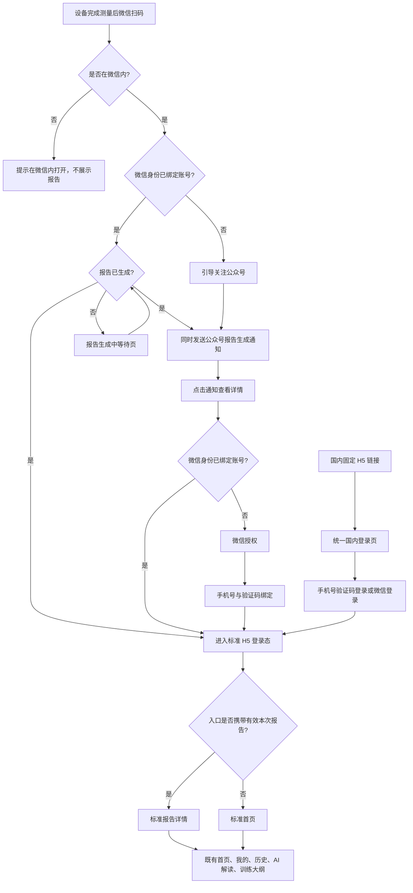
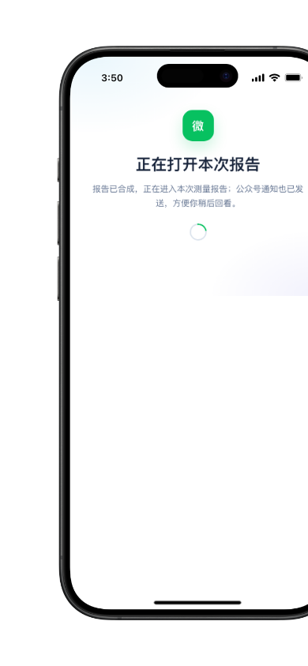
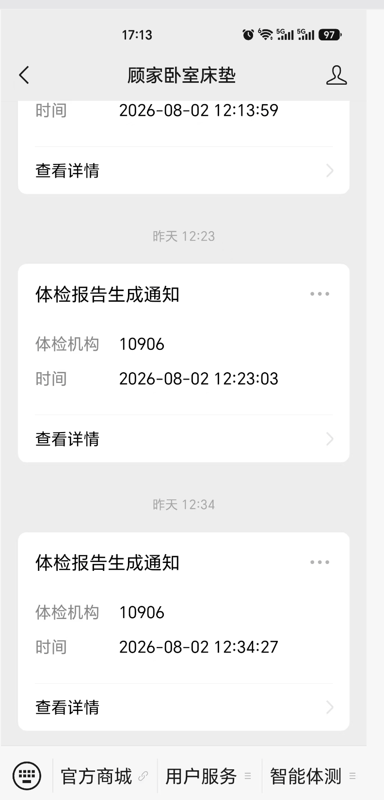
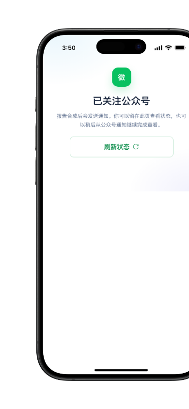

# WellnessHub H5 国内微信登录流程 PRD

本文定义 WellnessHub H5 的国内登录与报告承接流程。国内与海外只在进入 H5 前的身份识别方式不同；身份确认后必须复用同一套标准用户登录态、首页、报告、AI 解读、训练大纲和“我的”页面。本期为 H5 Demo 与后续正式接入的共同规则。

## 目标与入口

国内用户存在三类入口：固定链接、设备端二维码、公众号报告通知。固定链接不关联某份报告；设备二维码和公众号通知均关联一份本次测量报告。

| 入口 | 进入时是否有报告上下文 | 认证成功后的首个页面 |
| --- | --- | --- |
| 国内固定链接 | 否 | 标准首页 `#/home` |
| 设备端二维码 | 是 | 本次报告 `#/reports/{reportId}` |
| 公众号报告通知 | 是 | 本次报告 `#/reports/{reportId}` |

固定链接不得自动打开“最近一次报告”。扫码和通知入口只能打开凭证绑定的报告，不允许前端通过修改地址查看其他报告。

## 使用前提与降级

扫码和公众号通知是微信内服务入口，不应把“静默识别”和“通知送达”视为任何浏览器、任何时刻均可用的前提。

| 场景 | 用户看到的结果 | 处理规则 |
| --- | --- | --- |
| 在微信内扫描设备二维码或打开公众号通知 | 继续扫码或通知对应流程 | 后端以已配置的网页授权能力和已绑定身份校验测量归属。 |
| 非微信浏览器打开扫码或通知链接 | “请在微信内打开”提示 | 不泄露报告内容、不跳转其他报告；可返回国内固定登录页，但固定登录页不继承该报告上下文。 |
| 公众号通知发送失败 | 不影响老用户扫码即时查看 | 客户端不可将通知视为唯一凭证；已登录用户可由首页/报告列表回看，服务端记录失败、重试和客服处理状态。 |
| 新用户已关注但报告仍在生成 | “已关注公众号”状态页 | 显示等待状态和刷新动作；报告生成后发送通知，用户可停留在页面或稍后从通知继续。 |

静默识别仅用于已在该公众号身份体系内建立映射的用户；未建立映射的用户必须进入明确的授权与手机号绑定路径。不得在前端仅凭 `reportId`、二维码文本或最近报告推断用户身份与报告权限。

## 业务流程



已绑定用户的扫码与通知是两条并行路径：报告已生成时，扫码后立即打开本次报告；报告仍在生成时，扫码后进入合成中等待页，合成完成后自动进入本次报告。同时，无论用户是否停留在报告页，报告合成成功事件都会发送公众号通知；用户退出后可从通知再次打开同一份报告。整个老用户路径不展示微信授权、手机号绑定或“正在识别”中间页。新用户在通知链接内授权后完成一次手机号绑定；成功后，该微信身份与标准用户账号关联，未来可走老用户分支。



## 国内固定链接与统一登录页

固定链接进入后显示统一登录页骨架，沿用现有 H5 的品牌、背景、输入组件、协议及主按钮规格；不展示海外邮箱、Google、Facebook 等渠道。

国内登录页复用海外登录版式与组件层级，但凭证改为“手机号验证码”，第三方入口改为“微信登录”：

- 在微信内显示“微信登录”；非微信浏览器不显示微信入口，仅保留手机号验证码登录。
- 手机号验证码登录成功后直接进入首页；微信授权已识别到绑定账号时，显示“正在登录”，成功后进入首页。
- 授权已识别到绑定账号时，显示“正在登录”，成功后进入首页。
- 授权成功但尚未绑定账号时，进入手机号验证码绑定页。
- 手机号为 11 位中国大陆手机号；验证码为 6 位数字。验证码发送成功后显示倒计时，提交中禁止重复提交。
- 用户拒绝微信授权时，留在当前页，提示“需完成微信授权后才能继续登录”，并提供“重新授权”。
- 固定链接登录成功后不写入任何报告上下文，统一跳转 `#/home`。

国内身份入口不应放在海外邮箱登录页中，也不应在正式手机屏幕内暴露“国内／海外”切换。Demo 的地区与新老用户切换仅存在于设备屏幕外，用于演示场景。

## 设备扫码与公众号通知

设备二维码必须包含服务端签发、短时有效的测量访问凭证。H5 解析后只保存“待打开报告”上下文，不在前端推断或补充其他报告。

### 未绑定微信身份

用户扫描设备二维码后，展示公众号关注引导。引导内容只说明：关注后将在报告生成成功时收到通知；不应承诺测量完成即报告可用。

报告生成成功且用户已关注时，服务端发送一次公众号通知；若用户在报告生成后才完成关注，服务端补发一次。相同用户与相同报告不得重复发送成功通知。



上图是现有通知样例，仅说明公众号消息卡片信息结构；正式通知内容统一如下：

| 字段 | 规则 |
| --- | --- |
| 标题 | 固定为“体检报告生成通知” |
| 测量机构 | 当前报告所属门店或机构名称 |
| 时间 | 报告生成成功时间，格式 `YYYY-MM-DD HH:mm:ss` |
| 查看详情 | 打开携带报告访问凭证的 H5 链接 |

用户完成关注后，先读取报告状态：报告已生成时立即进入通知承接页；报告仍在生成时显示“已关注公众号”状态页，支持刷新，且可离开后从通知继续。未绑定用户从通知进入后，依次完成微信授权和手机号绑定；绑定成功后恢复标准用户登录态，并优先进入通知关联的本次报告。



### 已绑定微信身份

用户扫码后，系统使用微信静默身份识别将本次测量关联到已绑定的标准用户账号。报告已生成时，扫码直接打开本次报告；报告仍在生成时，显示等待页，合成完成后自动进入报告。报告生成成功事件同时发送公众号通知；用户退出后可从通知再次进入同一份报告。通知入口同样仅校验通知凭证与已绑定身份，不再次要求关注、微信授权确认或输入手机号。

通知发送失败不阻断上述扫码主链路。服务端需记录发送结果并按消息能力重试；H5 不展示“通知失败”的健康结论，已登录用户可经标准首页或报告列表恢复查看。

## 身份确认后的统一登录态与页面合流

国内身份确认后必须进入现有标准用户应用，不保留国内专属报告页、专属导航或游客只读壳。“恢复已绑定账号登录态”是服务端根据已绑定微信身份及有效通知凭证，为同一个既有账号复用或签发 H5 会话 Cookie／令牌的技术动作；它不是创建新账号，也不应向老用户展示页面或额外操作。

会话需要保存以下最小信息：

```ts
type AuthChannel = "email" | "phone" | "google" | "facebook" | "wechat";

type UserSession = {
  authenticated: true;
  userId: string;
  authChannel: AuthChannel;
  pendingReportId?: string;
};
```

- `authChannel` 仅记录认证来源，不能决定后续页面样式或功能范围。
- `pendingReportId` 仅来自已校验的扫码或通知访问凭证；进入目标报告后清除。
- 通知链接必须同时受报告范围、接收微信身份、有效期、撤销状态校验；不得将可猜测的 `reportId` 作为访问凭证。通知正文仅展示报告已生成、机构和时间，不展示健康结论、数值或其他敏感健康信息。
- 用户权限、历史报告、AI 解读、训练大纲和“我的”均按标准账号数据与现有权益规则读取。
- 训练大纲仍独立于 AI 报告解读；国内认证方式不改变二者的生成、查看和付费判断。

## 状态与异常

| 场景 | 页面反馈 | 恢复方式 |
| --- | --- | --- |
| 二维码无效、过期或报告不存在 | 明确说明本次测量不可访问 | 返回设备重新扫码 |
| 非微信浏览器打开扫码/通知链接 | “请在微信内打开” | 返回微信重新打开；固定链接登录不继承报告上下文 |
| 报告仍在生成 | 显示“报告正在生成，请稍后查看” | 公众号通知或重新打开原链接 |
| 公众号通知发送失败 | 不阻断老用户本次扫码查看；不暴露健康数据 | 服务端重试；用户从首页/报告列表回看 |
| 未关注公众号 | 展示关注引导 | 关注后等待或补发通知 |
| 微信授权被拒绝 | “需完成微信授权后才能继续登录” | 重新授权 |
| 手机号或验证码错误 | 字段下方显示对应错误，不清空已输入手机号 | 修改后重新提交 |
| 手机号已绑定其他微信账号 | 显示账号绑定冲突提示 | 联系机构或通过客服处理 |
| 报告访问权限不足 | “当前账号无权查看此报告” | 返回首页；不显示其他报告替代内容 |

## 服务端依赖与安全边界

本 PRD 的 Demo 可以模拟页面、状态与跳转，但以下能力必须由服务端提供：

- 微信公众号关注事件、OAuth 回调与 `openid/unionid` 账号绑定。
- 报告生成成功事件、公众号通知发送、去重与失败重试。
- 短期二维码／通知链接凭证的签发、过期、撤销和报告范围校验。
- 短信验证码发送、校验、频控和手机号绑定冲突处理。
- 报告、AI 解读和训练大纲的最终权限校验。

客户端不得把 `reportId` 视为访问凭证，不得因固定链接或登录成功自动选取任意“最近报告”。

## Demo 验收

- 屏幕外可切换海外、国内固定链接、国内扫码新用户、国内扫码老用户、报告状态、微信内/非微信和通知发送状态；正式手机界面不出现调试切换。
- 国内固定链接：手机号验证码或微信登录成功后进入 `#/home`；非微信浏览器不展示微信入口。
- 国内扫码／通知：新用户完成关注、通知、授权与绑定后进入指定报告；老用户报告已生成时扫码直接进入同一报告，报告生成中时进入等待页并在完成后自动进入报告；两种状态均在生成成功时发送通知，用于退出后的独立回看。
- 验证非微信打开扫码/通知时不显示报告；验证通知失败不阻断老用户扫码报告，并能从标准首页恢复查看；验证新用户关注后的生成中状态页及生成完成后的通知承接。
- 国内用户进入报告后，页面结构、底部导航、首页、“我的”、历史记录、AI 解读和训练大纲与海外标准用户一致。
- 失效二维码、报告生成中、拒绝授权、验证码错误、手机号绑定冲突和无报告权限均有明确提示，不跳转到其他报告或示例数据。
- Demo 不执行真实关注、短信、OAuth 或消息发送；测试数据不写入真实用户会话或报告数据。
